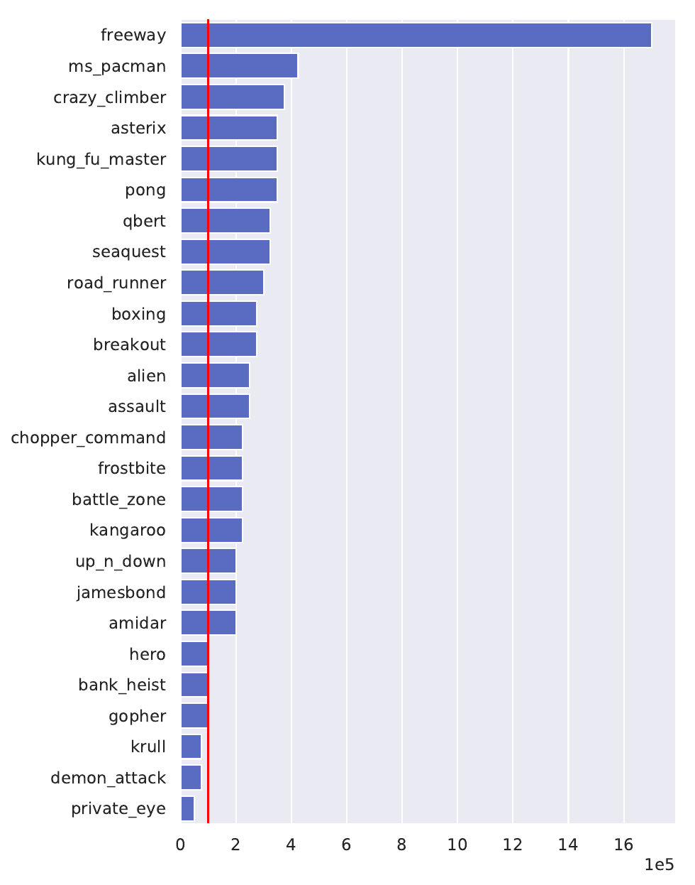
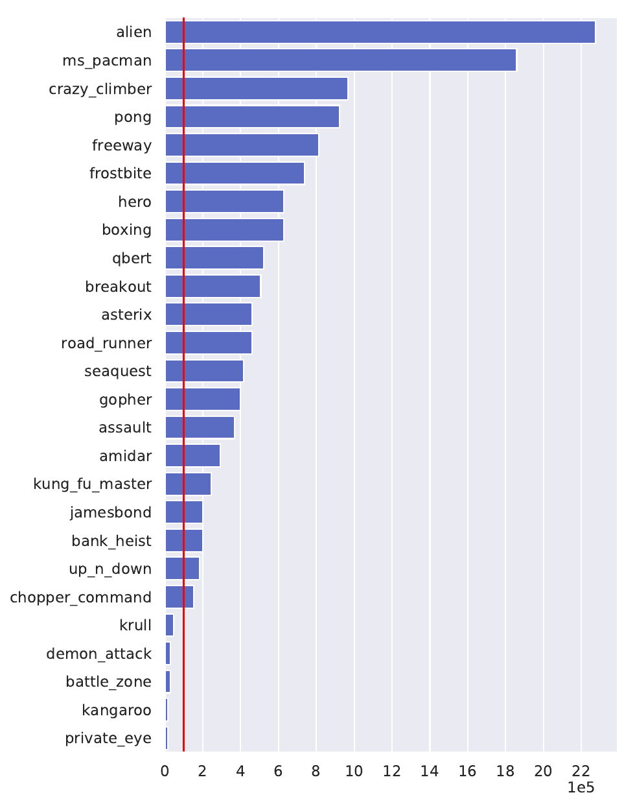
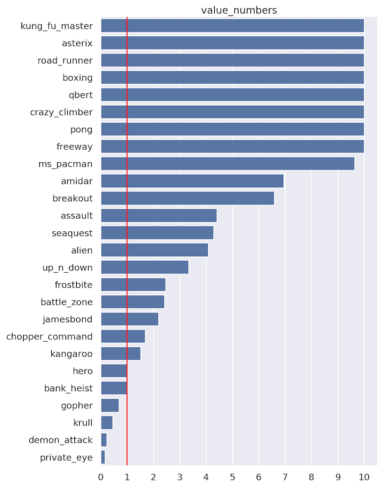
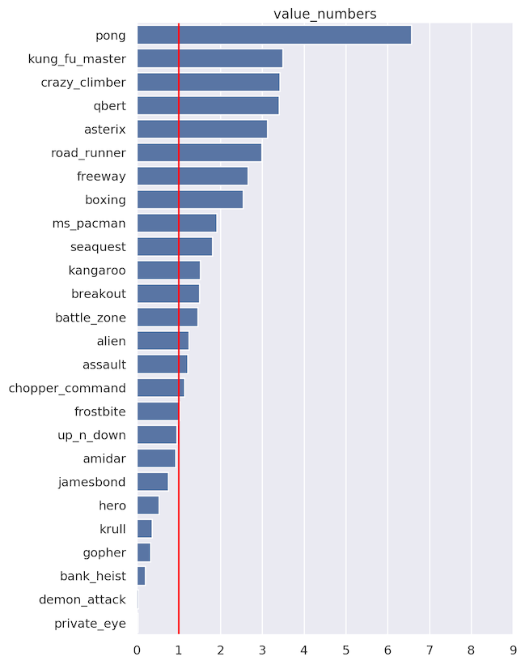
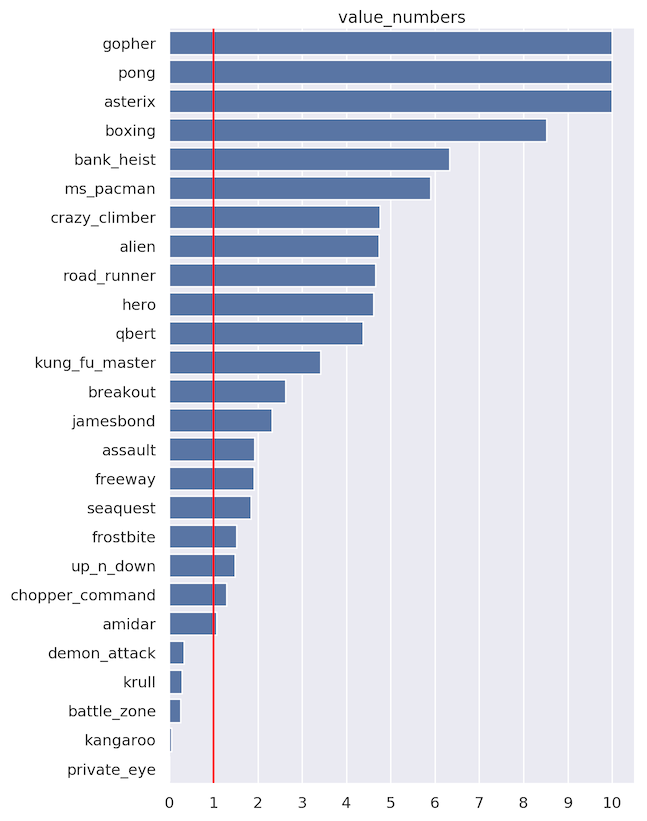
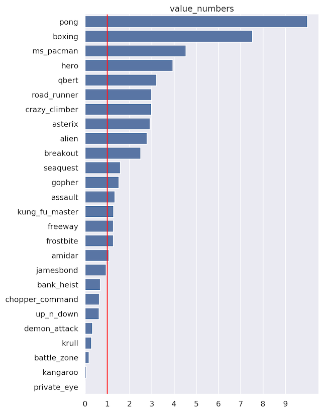
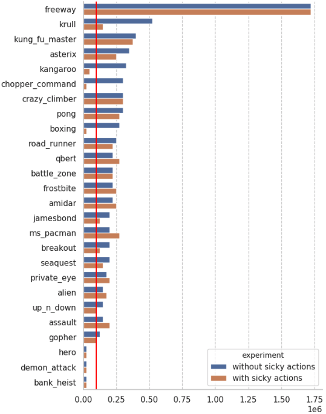
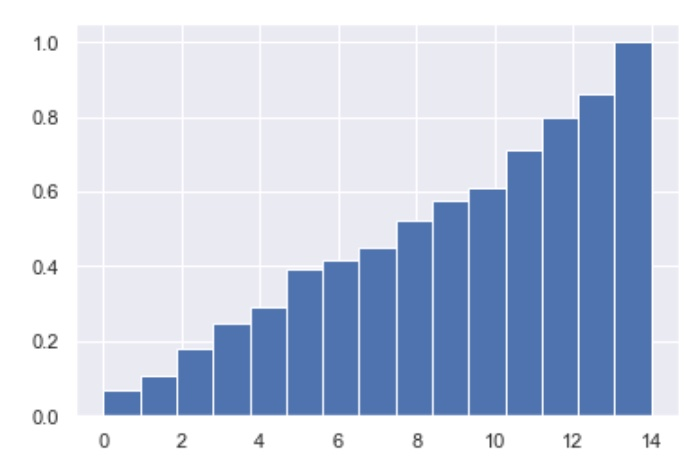
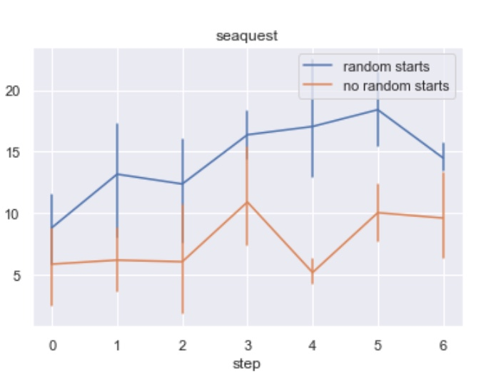

maketitle thanks aketitle

# Introduction

Human players can learn to play Atari games in
minutes [@human_atari_minutes]. However, some of the best model-free
reinforcement learning algorithms require tens or hundreds of millions
of time steps -- the equivalent of several weeks of training in real
time. How is it that humans can learn these games so much faster?
Perhaps part of the puzzle is that humans possess an intuitive
understanding of the physical processes that are represented in the
game: we know that planes can fly, balls can roll, and bullets can
destroy aliens. We can therefore predict the outcomes of our actions. In
this paper, we explore how learned video models can enable learning in
the Atari Learning Environment (ALE) benchmark [@ale; @ale2] with a
budget restricted to 100K time steps -- roughly to two hours of a play
time.

Although prior works have proposed training predictive models for
next-frame, future-frame, as well as combined future-frame and reward
predictions in Atari games
([@video_prediction; @recurrent; @video_reward_prediction]), no prior
work has successfully demonstrated model-based control via predictive
models that achieve competitive results with model-free RL. Indeed, in a
recent survey (Section 7.2 in @ale2) this was formulated as the
following challenge: "*So far, there has been no clear demonstration of
successful planning with a learned model in the ALE*".

Using models of environments, or informally giving the agent ability to
predict its future, has a fundamental appeal for reinforcement learning.
The spectrum of possible applications is vast, including learning
policies from the model
[@embed_to_control; @deep_spatial; @finn2016; @ebert; @hafner; @piergiovanni; @rybkin-pertsch; @sutton_barto_2017
Chapter 8], capturing important details of the scene [@world_models],
encouraging exploration [@video_prediction], creating intrinsic
motivation [@schmidhuber_formal_theory] or counterfactual reasoning
[@woulda_coulda_shoulda]. One of the exciting benefits of model-based
learning is the promise to substantially improve sample efficiency of
deep reinforcement learning (see Chapter 8 in [@sutton_barto_2017]).

Our work advances the state-of-the-art in model-based reinforcement
learning by introducing a system that, to our knowledge, is the first to
successfully handle a variety of challenging games in the ALE benchmark.
To that end, we experiment with several stochastic video prediction
techniques, including a novel model based on discrete latent variables.
We present an approach, called Simulated Policy Learning (SimPLe), that
utilizes these video prediction techniques and trains a policy to play
the game within the learned model. With several iterations of dataset
aggregation, where the policy is deployed to collect more data in the
original game, we learn a policy that, for many games, successfully
plays the game in the real environment (see videos on the project
webpage <https://goo.gl/itykP8>).

In our empirical evaluation, we find that SimPLe is significantly more
sample-efficient than a highly tuned version of the state-of-the-art
Rainbow algorithm [@rainbow] on almost all games. In particular, in low
data regime of $100$k samples, on more than half of the games, our
method achieves a score which Rainbow requires at least twice as many
samples. In the best case of `Freeway`, our method is more than 10x more
sample-efficient, see Figure
[3](#fig:compare_dopamine_ppo){reference-type="ref"
reference="fig:compare_dopamine_ppo"}. Since the publication of the
first preprint of this work, it has been shown in
[@nips/HasseltHA19; @kielak2020do] that Rainbow can be tuned to have
better results in low data regime. The results are on a par with SimPLe
-- both of the model-free methods are better in 13 games, while SimPLe
is better in the other 13 out of the total 26 games tested (note that in
Section 4.2 [@nips/HasseltHA19] compares with the results of our first
preprint, later improved).

![Main loop of SimPLe. 1) the agent starts interacting with the real
environment following the latest policy (initialized to random). 2) the
collected observations will be used to train (update) the current world
model. 3) the agent updates the policy by acting inside the world model.
The new policy will be evaluated to measure the performance of the agent
as well as collecting more data (back to 1). Note that world model
training is self-supervised for the observed states and supervised for
the reward.](figures/Cycle_full.png){#fig:main_cycle width="75%"}

# Related Work {#sec:related_work}

Atari games gained prominence as a benchmark for reinforcement learning
with the introduction of the Arcade Learning Environment (ALE) [@ale].
The combination of reinforcement learning and deep models then enabled
RL algorithms to learn to play Atari games directly from images of the
game screen, using variants of the DQN algorithm [@dqn; @dqn2; @rainbow]
and actor-critic algorithms [@a3c; @ppo; @ga3c; @acktr; @vtrace]. The
most successful methods in this domain remain model-free
algorithms [@rainbow; @vtrace]. Although the sample complexity of these
methods has substantially improved recently, it remains far higher than
the amount of experience required for human players to learn each
game [@human_atari_minutes]. In this work, we aim to learn Atari games
with a budget of just 100K agent steps (400K frames), corresponding to
about two hours of play time. Prior methods are generally not evaluated
in this regime, and we therefore optimized Rainbow [@rainbow] for
optimal performance on 1M steps, see Appendix
[12](#sec:baselines_optimizations){reference-type="ref"
reference="sec:baselines_optimizations"} for details.

@video_prediction and @recurrent show that learning predictive models of
Atari 2600 environments is possible using appropriately chosen deep
learning architectures. Impressively, in some cases the predictions
maintain low $L_2$ error over timespans of hundreds of steps. As learned
simulators of Atari environments are core ingredients of our approach,
in many aspects our work is motivated by @video_prediction and
@recurrent, however we focus on using video prediction in the context of
learning how to play the game well and positively verify that learned
simulators can be used to train a policy useful in original
environments. An important step in this direction was made by
@video_reward_prediction, which extends the work of @video_prediction by
including reward prediction, but does not use the model to learn
policies that play the games. Most of these approaches, including ours,
encode knowledge of the game in implicit way. Unlike this, there are
works in which modeling is more explicit, for example
[@ersen2014learning] uses testbed of the Incredible Machines to learn
objects behaviors and their interactions. Similarly @guzdial2017game
learns an engine predicting interactions of predefined set of sprites in
the domain of Super Mario Bros.

Perhaps surprisingly, there is virtually no work on model-based RL in
video games from images. Notable exceptions are the works of @vpn,
@sodhani2019learning, @world_models, @dyna_dqn, [@leibfried2018model]
and @gats. @vpn use a model of rewards to augment model-free learning
with good results on a number of Atari games. However, this method does
not actually aim to model or predict future frames, and achieves clear
but relatively modest gains in efficiency. @sodhani2019learning proposes
learning a model consistent with RNN policy which helps to train
policies that are more powerful than their model-free baseline.
@world_models present a way to compose a variational autoencoder with a
recurrent neural network into an architecture that is successfully
evaluated in the VizDoom environment and on a 2D racing game. The
training procedure is similar to Algorithm
[\[alg:basic_loop\]](#alg:basic_loop){reference-type="ref"
reference="alg:basic_loop"}, but only one iteration of the loop is
needed as the environments are simple enough to be fully explored with
random exploration. Similarly, @alaniz2018deep utilizes a transition
model with Monte Carlo tree search to solve a block-placing task in
Minecraft. @dyna_dqn use a variant of Dyna [@dyna] to learn a model of
the environment and generate experience for policy training in the
context of Atari games. Using six Atari games as a benchmark @dyna_dqn
measure the impact of planning shapes on performance of the Dyna-DQN
algorithm and include ablations comparing scores obtained with perfect
and imperfect models. Our method achieves around 330% of the Dyna-DQN
score on Asterix, 120% on Q-Bert, 150% on Seaquest and 80% on Ms.
Pac-Man. [@gats] propose an algorithm called Generative Adversarial Tree
Search (GATS) and for five Atari games train a GAN-based world model
along with a Q-function. [@gats] primarily discuss various failure modes
of the GATS algorithm. Our method achieves around 64 times the score of
GATS on Pong and 10 times on Breakout. [^2]

Outside of games, model-based reinforcement learning has been
investigated at length for applications such as robotics [@deisenroth].
Though most of such works do not use image observations, several recent
works have incorporated images into
real-world [@deep_spatial; @finn2016; @sv2p; @ebert; @piergiovanni; @paxton; @rybkin-pertsch; @ebert2018visual]
and simulated [@embed_to_control; @hafner] robotic control. Our video
models of Atari environments described in Section
[\[sec:architectures\]](#sec:architectures){reference-type="ref"
reference="sec:architectures"} are motivated by models developed in the
context of robotics. Another source of inspiration are discrete
autoencoders proposed by @neural_discrete and @auto_discrete.

The structure of the model-based RL algorithm that we employ consists of
alternating between learning a model, and then using this model to
optimize a policy with model-free reinforcement learning. Variants of
this basic algorithm have been proposed in a number of prior works,
starting from Dyna Q [@dyna] to more recent methods that incorporate
deep networks
[@stochastic_value_gradients; @model_based_value_estimation; @uncertainty_driven_imagination; @trpo_ensemble].

# Simulated Policy Learning (SimPLe) {#subsec:model}

[]{#sec:mbrl label="sec:mbrl"}

Reinforcement learning is formalized in Markov decision processes (MDP).
An MDP is defined as a tuple
$(\mathcal{S}, {\mathcal A}, P, r, \gamma)$, where $\mathcal{S}$ is a
state space, ${\mathcal A}$ is a set of actions available to an agent,
$P$ is the unknown transition kernel, $r$ is the reward function and
$\gamma\in (0,1)$ is the discount factor. In this work we refer to MDPs
as environments and assume that environments do not provide direct
access to the state (i.e., the RAM of Atari 2600 emulator). Instead we
use visual observations, typically $210\times 160$ RGB images. A single
image does not determine the state. In order to reduce environment's
partial observability, we stack four consecutive frames and use it as
the observation. A reinforcement learning agent interacts with the MDP
by issuing actions according to a policy. Formally, policy $\pi$ is a
mapping from states to probability distributions over $\mathcal{A}$. The
quality of a policy is measured by the value function
$\mathbb{E}_{\pi}\left(\sum_{t=0}^{+\infty}\gamma^t r_{t+1}|s_0=s \right)$,
which for a starting state $s$ estimates the total discounted reward
gathered by the agent.

::::: wrapfigure
r0.45

:::: algorithm
::: algorithmic
Initialize policy $\boldsymbol\pi$ Initialize model parameters
$\boldsymbol\theta$ of $env'$ Initialize empty set $\mathbf{D}$
[$\triangleright$ collect observations from real env.]{.underline}
$\mathbf{D} \gets \mathbf{D} \cup \text{COLLECT($env$, $\pi$)}$
[$\triangleright$ update model using collected data.]{.underline}
$\boldsymbol\theta \gets \text{TRAIN\_SUPERVISED}(env', \mathbf{D})$
[$\triangleright$ update policy using world model.]{.underline}
$\boldsymbol\pi \gets \text{TRAIN\_RL}(\boldsymbol\pi, env')$
:::

[]{#basic_loop label="basic_loop"} []{#alg:basic_loop
label="alg:basic_loop"}
::::
:::::

In Atari 2600 games our goal is to find a policy which maximizes the
value function from the beginning of the game. Crucially, apart from an
Atari 2600 emulator environment $env$ we will use *a neural network
simulated environment* $env'$ which we call a *world model* and describe
in detail in Section
[\[sec:world_models\]](#sec:world_models){reference-type="ref"
reference="sec:world_models"}. The environment $env'$ shares the action
space and reward space with $env$ and produces visual observations in
the same format, as it will be trained to mimic $env$. Our principal aim
is to train a policy $\pi$ using a simulated environment $env'$ so that
$\pi$ achieves good performance in the original environment $env$. In
this training process we aim to use as few interactions with $env$ as
possible. The initial data to train $env'$ comes from random rollouts of
$env$. As this is unlikely to capture all aspects of $env$, we use the
iterative method presented in
Algorithm [\[alg:basic_loop\]](#alg:basic_loop){reference-type="ref"
reference="alg:basic_loop"}.

![Architecture of the proposed stochastic model with discrete latent.
The input to the model is four stacked frames (as well as the action
selected by the agent) while the output is the next predicted frame and
expected reward. Input pixels and action are embedded using fully
connected layers, and there is per-pixel softmax ($256$ colors) in the
output. This model has two main components. First, the bottom part of
the network which consists of a skip-connected convolutional encoder and
decoder. To condition the output on the actions of the agent, the output
of each layer in the decoder is multiplied with the (learned) embedded
action. Second part of the model is a convolutional inference network
which approximates the posterior given the next frame, similarly
to @sv2p. At training time, the sampled latent values from the
approximated posterior will be discretized into bits. To keep the model
differentiable, the backpropagation bypasses the discretization
following @auto_discrete. A third LSTM based network is trained to
approximate each bit given the previous ones. At inference time, the
latent bits are predicted auto-regressively using this network. The
deterministic model has the same architecture as this figure but without
the inference network.](figures/model_basic_disc.pdf){#fig:full_discrete
width="88%"}

# World Models

[]{#sec:world_models label="sec:world_models"} []{#sec:architectures
label="sec:architectures"} []{#sec:training label="sec:training"}

In search for an effective world model we experimented with various
architectures, both new and modified versions of existing ones. This
search resulted in a novel stochastic video prediction model (visualized
in Figure [2](#fig:full_discrete){reference-type="ref"
reference="fig:full_discrete"}) which achieved superior results compared
to other previously proposed models. In this section, we describe the
details of this architecture and the rationale behind our design
decisions. In Section
[\[sec:analysis\]](#sec:analysis){reference-type="ref"
reference="sec:analysis"} we compare the performance of these models.

**Deterministic Model.** Our basic architecture, presented as part of
Figure [2](#fig:full_discrete){reference-type="ref"
reference="fig:full_discrete"}, resembles the convolutional feedforward
network from @video_prediction. The input $X$ consists of four
consecutive game frames and an action $a$. Stacked convolution layers
process the visual input. The actions are one-hot-encoded and embedded
in a vector which is multiplied channel-wise with the output of the
convolutional layers. The network outputs the next frame of the game and
the value of the reward.

In our experiments, we varied details of the architecture above. In most
cases, we use a stack of four convolutional layers with $64$ filters
followed by three dense layers (the first two have $1024$ neurons). The
dense layers are concatenated with $64$ dimensional vector with a
learnable action embedding. Next, three deconvolutional layers of $64$
filters follow. An additional deconvolutional layer outputs an image of
the original $105\times 80$ size. The number of filters is either $3$ or
$3 \times 256$. In the first case, the output is a real-valued
approximation of pixel's RGB value. In the second case, filters are
followed by softmax producing a probability distribution on the color
space. The reward is predicted by a softmax attached to the last fully
connected layer. We used dropout equal to $0.2$ and layer normalization.

**Loss functions.** The visual output of our networks is either one
float per pixel/channel or the categorical 256-dimensional softmax. In
both cases, we used the *clipped loss* $\max(Loss, C)$ for a constant
$C$. We found that clipping was crucial for improving the models
(measured with the correct reward predictions per sequence metric and
successful training using
Algorithm [\[dpll\]](#dpll){reference-type="ref" reference="dpll"}). We
conjecture that clipping substantially decreases the magnitude of
gradients stemming from fine-tuning of big areas of background
consequently letting the optimization process concentrate on small but
important areas (e.g. the ball in Pong). In our experiments, we set
$C=10$ for $L_2$ loss on pixel values and to $C=0.03$ for softmax loss.
Note that this means that when the level of confidence about the correct
pixel value exceeds $97\%$ (as $-\ln(0.97) \approx 0.03$) we get no
gradients from that pixel any longer.

**Scheduled sampling.** The model $env'$ consumes its own predictions
from previous steps and due to compounding errors, the model may drift
out of the area of its applicability. Following
[@BengioVJS15; @venkatraman], we mitigate this problem by randomly
replacing in training some frames of the input $X$ by the prediction
from the previous step while linearly increasing the mixing probability
to $100\%$ around the middle of the first iteration of the training
loop.

**Stochastic Models.** A stochastic model can be used to deal with
limited horizon of past observed frames as well as sprites occlusion and
flickering which results to higher quality predictions. Inspired
by @sv2p, we tried a variational autoencoder [@kingma2013auto] to model
the stochasticity of the environment. In this model, an additional
network receives the input frames as well as the future target frame as
input and approximates the distribution of the posterior. At each
timestep, a latent value $z_t$ is sampled from this distribution and
passed as input to the original predictive model. At test time, the
latent values are sampled from an assumed prior
$\mathcal{N}(\mathbf{0}, \mathbf{I})$. To match the assumed prior and
the approximate, we use the Kullback--Leibler divergence term as an
additional loss term [@sv2p].

We noticed two major issues with the above model. First, the weight of
the KL divergence loss term is game dependent, which is not practical if
one wants to deal with a broad portfolio of Atari games. Second, this
weight is usually a very small number in the range of
$[10^{-3}, 10^{-5}]$ which means that the approximated posterior can
diverge significantly from the assumed prior. This can result in
previously unseen latent values at inference time that lead to poor
predictions. We address these issues by utilizing a discrete latent
variable similar to @auto_discrete.

As visualized in Figure [2](#fig:full_discrete){reference-type="ref"
reference="fig:full_discrete"}, the proposed stochastic model with
discrete latent variables discretizes the latent values into bits (zeros
and ones) while training an auxiliary LSTM-based [@hochreiter1997long]
recurrent network to predict these bits autoregressively. At inference
time, the latent bits will be generated by this auxiliary network in
contrast to sampling from a prior. To make the predictive model more
robust to unseen latent bits, we add uniform noise to approximated
latent values before discretization and apply
dropout [@srivastava2014dropout] on bits after discretization. More
details about the architecture is in Appendix
[10](#sec:architecture-details){reference-type="ref"
reference="sec:architecture-details"}.

# Policy Training {#sec:policy_training}

We will now describe the details of SimPLe, outlined in Algorithm
[\[alg:basic_loop\]](#alg:basic_loop){reference-type="ref"
reference="alg:basic_loop"}. In step 6 we use the proximal policy
optimization (PPO) algorithm [@ppo] with $\gamma=0.95$. The algorithm
generates rollouts in the simulated environment $env'$ and uses them to
improve policy $\pi$. The fundamental difficulty lays in imperfections
of the model compounding over time. To mitigate this problem we use
short rollouts of $env'$. Typically every $N=50$ steps we uniformly
sample the starting state from the ground-truth buffer $D$ and restart
$env'$ (for experiments with the value of $\gamma$ and $N$ see
Section [6.4](#subabl){reference-type="ref" reference="subabl"}). Using
short rollouts may have a degrading effect as the PPO algorithm does not
have a way to infer effects longer than the rollout length. To ease this
problem, in the last step of a rollout we add to the reward the
evaluation of the value function. Training with multiple iterations
re-starting from trajectories gathered in the real environment is new to
our knowledge. It was inspired by the classical Dyna-Q algorithm and,
notably, in the Atari domain no comparable results have been achieved.

The main loop in Algorithm [\[dpll\]](#dpll){reference-type="ref"
reference="dpll"} is iterated $15$ times (cf.
Section [6.4](#subabl){reference-type="ref" reference="subabl"}). The
world model is trained for $45$K steps in the first iteration and for
$15$K steps in each of the following ones. Shorter training in later
iterations does not degrade the performance because the world model
after first iteration captures already part of the game dynamics and
only needs to be extended to novel situations.

In each of the iterations, the agent is trained inside the latest world
model using PPO. In every PPO epoch we used 16 parallel agents
collecting 25, 50 or 100 steps from the simulated environment $env'$
(see Section [6.4](#subabl){reference-type="ref" reference="subabl"} for
ablations). The number of PPO epochs is $z\cdot 1000$, where $z$ equals
to 1 in all passes except last one (where $z = 3$) and two passes number
8 and 12 (where $z = 2$). This gives $800$K$\cdot z$ interactions with
the simulated environment in each of the loop passes. In the process of
training the agent performs $15.2$M interactions with the simulated
environment $env'$.

# Experiments {#sec:experiments}

[]{#sec:analysis label="sec:analysis"}

We evaluate SimPLe on a suite of Atari games from Atari Learning
Environment (ALE) benchmark. In our experiments, the training loop is
repeated for 15 iterations, with $6400$ interactions with the
environment collected in each iteration. We apply a standard
pre-processing for Atari games: a frame skip equal to 4, that is every
action is repeated 4 times. The frames are down-scaled by a factor of
$2$.

Because some data is collected before the first iteration of the loop,
altogether $6400 \cdot 16 = 102,400$ interactions with the Atari
environment are used during training. This is equivalent to $409,600$
frames from the Atari game (114 minutes at 60 FPS). At every iteration,
the latest policy trained under the learned model is used to collect
data in the real environment ${\texttt{env}}$. The data is also directly
used to train the policy with PPO. Due to vast difference between number
of training data from simulated environment and real environment (15M vs
100K) the impact of the latter on policy is negligible.

We evaluate our method on $26$ games selected on the basis of being
solvable with existing state-of-the-art model-free deep RL
algorithms[^3], which in our comparisons are Rainbow [@rainbow] and
PPO [@ppo]. For Rainbow, we used the implementation from the Dopamine
package and spent considerable time tuning it for sample efficiency (see
Appendix [12](#sec:baselines_optimizations){reference-type="ref"
reference="sec:baselines_optimizations"}).

For visualization of all experiments see <https://goo.gl/itykP8> and for
a summary see Figure [3](#fig:compare_dopamine_ppo){reference-type="ref"
reference="fig:compare_dopamine_ppo"}. It can be seen that our method is
more sample-efficient than a highly tuned Rainbow baseline on almost all
games, requires less than half of the samples on more than half of the
games and, on `Freeway`, is more than 10x more sample-efficient. Our
method outperforms PPO by an even larger margin. We also compare our
method with fixed score baselines (for different baselines) rather than
counting how many steps are required to match our score, see
Figure [4](#fig:compare_scores){reference-type="ref"
reference="fig:compare_scores"} for the results. For the qualitative
analysis of performance on different games see Appendix
[9](#qualitative_analysis){reference-type="ref"
reference="qualitative_analysis"}. The source code is available as part
of the Tensor2Tensor library and it includes instructions on how to run
the experiments[^4].

<figure id="fig:compare_dopamine_ppo">

<figcaption>Comparison with Rainbow and PPO. Each bar illustrates the
number of interactions with environment required by Rainbow (left) or
PPO (right) to achieve the same score as our method (SimPLe). The red
line indicates the 100K interactions
threshold which is used by the our method.</figcaption>
</figure>

## Sample Efficiency

The primary evaluation in our experiments studies the sample efficiency
of SimPLe, in comparison with state-of-the-art model-free deep RL
methods in the literature. To that end, we compare with
Rainbow [@rainbow; @DBLP:journals/corr/abs-1812-06110], which represents
the state-of-the-art Q-learning method for Atari games, and PPO [@ppo],
a model-free policy gradient algorithm (see Appendix
[12](#sec:baselines_optimizations){reference-type="ref"
reference="sec:baselines_optimizations"} for details of tuning of
Rainbow and PPO). The results of the comparison are presented in
Figure [3](#fig:compare_dopamine_ppo){reference-type="ref"
reference="fig:compare_dopamine_ppo"}. For each game, we plot the number
of time steps needed for either Rainbow or PPO to reach the same score
that our method reaches after $100$K interaction steps. The red line
indicates $100$K steps: any bar larger than this indicates a game where
the model-free method required more steps. SimPLe outperforms the
model-free algorithms in terms of learning speed on nearly all of the
games, and in the case of a few games, does so by over an order of
magnitude. For some games, it reaches the same performance that our PPO
implementation reaches at $10$M steps. This indicates that model-based
reinforcement learning provides an effective approach to learning Atari
games, at a fraction of the sample complexity.

The results in these figures are generated by averaging $5$ runs for
each game. The model-based agent is better than a random policy for all
the games except `Bank Heist`. Interestingly, we observed that the best
of the $5$ runs was often significantly better. For $6$ of the games, it
exceeds the average human score (as reported in Table 3 of
[@Pohlenetal2018]). This suggests that further stabilizing SimPLe should
improve its performance, indicating an important direction for future
work. In some cases during training we observed high variance of the
results during each step of the loop. There are a number of possible
reasons, such as mutual interactions of the policy training and the
supervised training or domain mismatch between the model and the real
environment. We present detailed numerical results, including best
scores and standard deviations, in Appendix
[11](#numerical_results){reference-type="ref"
reference="numerical_results"}.

<figure id="fig:compare_scores">

  

<figcaption>Fractions of Rainbow and PPO scores at different numbers of
interactions calculated with the formula (<em>S</em><em>i</em><em>m</em><em>P</em><em>L</em><em>e</em>_<em>s</em><em>c</em><em>o</em><em>r</em><em>e</em>@100<em>K</em> − <em>r</em><em>a</em><em>n</em><em>d</em><em>o</em><em>m</em>_<em>s</em><em>c</em><em>o</em><em>r</em><em>e</em>)/(<em>b</em><em>a</em><em>s</em><em>e</em><em>l</em><em>i</em><em>n</em><em>e</em>_<em>s</em><em>c</em><em>o</em><em>r</em><em>e</em> − <em>r</em><em>a</em><em>n</em><em>d</em><em>o</em><em>m</em>_<em>s</em><em>c</em><em>o</em><em>r</em><em>e</em>);
if denominator is smaller than 0, both nominator and denominator are
increased by 1. From left to right, the baselines are: Rainbow at 100K,
Rainbow at 200K, PPO at 100K, PPO at 200K. SimPLe outperforms Rainbow
and PPO even when those are given twice as many
interactions.</figcaption>
</figure>

## Number of frames

We focused our work on learning games with $100$K interaction steps with
the environment. In this section we present additional results for
settings with $20$K, $50$K, $200$K, $500$K and $1$M interactions; see
Figure [5](#fig:numberOfStepsMT){reference-type="ref"
reference="fig:numberOfStepsMT"} (a). Our results are poor with $20$K
interactions. For $50$K they are already almost as good as with $100$K
interactions. From there the results improve until $500$K samples -- it
is also the point at which they are on par with model-free PPO. Detailed
per game results can be found in
Appendix [13](#appdx:num_samples){reference-type="ref"
reference="appdx:num_samples"}.

This demonstrates that SimPLe excels in a low data regime, but its
advantage disappears with a bigger amount of data. Such a behavior, with
fast growth at the beginning of training, but lower asymptotic
performance is commonly observed when comparing model-based and
model-free methods (@benchmarkingmbrl). As observed in Section
[6.4](#subabl){reference-type="ref" reference="subabl"} assigning bigger
computational budget helps in $100$K setting. We suspect that gains
would be even bigger for the settings with more samples.

Finally, we verified if a model obtained with SimPLe using $100$K is a
useful initialization for model-free PPO training. Based on the results
depicted in Figure [5](#fig:numberOfStepsMT){reference-type="ref"
reference="fig:numberOfStepsMT"} (b) we can positively answer this
conjecture. Lower asymptotic performance is probably due to worse
exploration. A policy pre-trained with SimPLe was meant to obtain the
best performance on $100$K, at which point its entropy is very low thus
hindering further PPO training.

<figure id="fig:numberOfStepsMT">
<table>
<tbody>
<tr>
<td style="text-align: center;"></td>
<td style="text-align: center;"></td>
</tr>
</tbody>
</table>
<figcaption>Behaviour with respect to the number of used samples. We
report number of frames required by PPO to reach the score of our
models. Results are averaged over all games.</figcaption>
</figure>

## Environment stochasticity

A crucial decision in the design of world models is the inclusion of
stochasticity. Although Atari is known to be a deterministic
environment, it is stochastic given only a limited horizon of past
observed frames (in our case $4$ frames). The level of stochasticity is
game dependent; however, it can be observed in many Atari games. An
example of such behavior can be observed in the game `Kung Fu Master` --
after eliminating the current set of opponents, the game screen always
looks the same (it contains only player's character and the background).
The game dispatches diverse sets of new opponents, which cannot be
inferred from the visual observation alone (without access to the game's
internal state) and thus cannot be predicted by a deterministic model.
Similar issues have been reported in [@sv2p], where the output of their
baseline deterministic model was a blurred superposition of possible
random object movements. As can be seen in
Figure [10](#fig:kungfu){reference-type="ref" reference="fig:kungfu"} in
the Appendix, the stochastic model learns a reasonable behavior --
samples potential opponents and renders them sharply.

::: wrapfigure
r0.45[]{#fig:sticky label="fig:sticky"}
{width="45%"}
:::

Given the stochasticity of the proposed model, SimPLe can be used with
truly stochastic environments. To demonstrate this, we ran an experiment
where the full pipeline (both the world model and the policy) was
trained in the presence of sticky actions, as recommended in [@ale2
Section 5]. Our world model learned to account for the stickiness of
actions and in most cases the end results were very similar to the ones
for the deterministic case even without any tuning, see
Figure [\[fig:sticky\]](#fig:sticky){reference-type="ref"
reference="fig:sticky"}.

## Ablations {#subabl}

To evaluate the design of our method, we independently varied a number
of the design decisions. Here we present an overview; see
Appendix [8](#sec:ablations){reference-type="ref"
reference="sec:ablations"} for detailed results.\
**Model architecture and hyperparameters.** We evaluated a few choices
for the world model and our proposed stochastic discrete model performs
best by a significant margin. The second most important parameter was
the length of world model's training. We verified that a longer training
would be beneficial, however we had to restrict it in all other ablation
studies due to a high cost of training on all games. As for the length
of rollouts from simulated $env'$, we use $N=50$ by default. We
experimentally shown that $N=25$ performs roughly on par, while $N=100$
is slightly worse, likely due to compounding model errors. The *discount
factor* was set to $\gamma=0.99$ unless specified otherwise. We see that
$\gamma=0.95$ is slightly better than other values, and we hypothesize
that it is due to better tolerance to model imperfections. But overall,
all three values of $\gamma$ perform comparably.\
**Model-based iterations.** The iterative process of training the model,
training the policy, and collecting data is crucial for non-trivial
tasks where random data collection is insufficient. In a game-by-game
analysis, we quantified the number of games where the best results were
obtained in later iterations of training. In some games, good policies
could be learned very early. While this might have been due to the high
variability of training, it does suggest the possibility of much faster
training (i.e. in fewer step than 100k) with more directed exploration
policies. In Figure [8](#fig:Cdf){reference-type="ref"
reference="fig:Cdf"} in the Appendix we present the cumulative
distribution plot for the (first) point during learning when the maximum
score for the run was achieved in the main training loop of
Algorithm [\[alg:basic_loop\]](#alg:basic_loop){reference-type="ref"
reference="alg:basic_loop"}.\
**Random starts.** Using short rollouts is crucial to mitigate the
compounding errors in the model. To ensure exploration, SimPLe starts
rollouts from randomly selected states taken from the real data buffer
$\textsc{D}$. Figure [8](#fig:Cdf){reference-type="ref"
reference="fig:Cdf"} compares the baseline with an experiment without
random starts and rollouts of length $1000$ on `Seaquest` which shows
much worse results without random starts.

# Conclusions and Future Work

We presented SimPLe, a model-based reinforcement learning approach that
operates directly on raw pixel observations and learns effective
policies to play games in the Atari Learning Environment. Our
experiments demonstrate that SimPLe learns to play many of the games
with just $100$K interactions with the environment, corresponding to 2
hours of play time. In many cases, the number of samples required for
prior methods to learn to reach the same reward value is several times
larger.

Our predictive model has stochastic latent variables so it can be
applied in highly stochastic environments. Studying such environments is
an exciting direction for future work, as is the study of other ways in
which the predictive neural network model could be used. Our approach
uses the model as a learned simulator and directly applies model-free
policy learning to acquire the policy. However, we could use the model
for planning. Also, since our model is differentiable, the additional
information contained in its gradients could be incorporated into the
reinforcement learning process. Finally, the representation learned by
the predictive model is likely be more meaningful by itself than the raw
pixel observations from the environment. Incorporating this
representation into the policy could further accelerate and improve the
reinforcement learning process.

While SimPLe is able to learn more quickly than model-free methods, it
does have limitations. First, the final scores are on the whole lower
than the best state-of-the-art model-free methods. This can be improved
with better dynamics models and, while generally common with model-based
RL algorithms, suggests an important direction for future work. Another,
less obvious limitation is that the performance of our method generally
varied substantially between different runs on the same game. The
complex interactions between the model, policy, and data collection were
likely responsible for this. In future work, models that capture
uncertainty via Bayesian parameter posteriors or ensembles
[@trpo_ensemble; @Chua18] may improve robustness. Finally, the
computational and time requirement of training inside world model are
substantial (see Appendix
[10](#sec:architecture-details){reference-type="ref"
reference="sec:architecture-details"}), which makes developing lighter
models an important research direction.

In this paper our focus was to demonstrate the capability and generality
of SimPLe only across a suite of Atari games, however, we believe
similar methods can be applied to other environments and tasks which is
one of our main directions for future work. As a long-term challenge, we
believe that model-based reinforcement learning based on stochastic
predictive models represents a promising and highly efficient
alternative to model-free RL. Applications of such approaches to both
high-fidelity simulated environments and real-world data represent an
exciting direction for future work that can enable highly efficient
learning of behaviors from raw sensory inputs in domains such as
robotics and autonomous driving.

## Acknowledgments {#acknowledgments .unnumbered}

We thank Marc Bellemare and Pablo Castro for their help with Rainbow and
Dopamine. The work of Konrad Czechowski, Piotr Kozakowski and Piotr
Miłoś was supported by the Polish National Science Center grants
UMO-2017/26/E/ST6/00622. The work of Henryk Michalewski was supported by
the Polish National Science Center grant UMO-2018/29/B/ST6/02959. We
gratefully acknowledge Polish high-performance computing infrastructure
PLGrid (HPC Centers: ACK Cyfronet AGH, PCSS) for providing computer
facilities and support within computational grants no. PLG/2019/012497
and PLG/2019/012784. Some of the experiments were managed using
<https://neptune.ai>. We would like to thank the Neptune team for
providing us access to the team version and technical support.

All our code is available as part of the Tensor2Tensor library and it
includes instructions on how to run our experiments:
<https://github.com/tensorflow/tensor2tensor/tree/master/tensor2tensor/rl>.

# Ablations {#sec:ablations}

To evaluate the design of our method, we independently varied a number
of the design decisions: the choice of the model, the $\gamma$ parameter
and the length of PPO rollouts. The results for $7$ experimental
configurations are summarized in the Table
[1](#tab:count_best_models){reference-type="ref"
reference="tab:count_best_models"}.

:::: center
::: {#tab:count_best_models}
  model               best   at least median
  ----------------- ------ -----------------
  deterministic        $0$               $7$
  det. recurrent       $3$              $13$
  SD                   $8$              $16$
  SD $\gamma=0.9$      $1$              $14$
  default             $10$              $21$
  SD $100$ steps       $0$              $14$
  SD $25$ steps        $4$              $19$

  : **Summary of SimPLe ablations.** For each game, a configuration was
  assigned a score being the mean over $5$ experiments. The best and
  median scores were calculated per game. The table reports the number
  of games a given configuration achieved the best score or at least the
  median score, respectively.
:::
::::

[]{#tab:count_best_models label="tab:count_best_models"}

#### Models.

To assess the model choice, we evaluated the following models:
deterministic, deterministic recurrent, and stochastic discrete (see
Section [\[sec:architectures\]](#sec:architectures){reference-type="ref"
reference="sec:architectures"}). Based on
Table [1](#tab:count_best_models){reference-type="ref"
reference="tab:count_best_models"} it can be seen that our proposed
stochastic discrete model performs best. Figures
[\[fig:ablations_stochasticity\]](#fig:ablations_stochasticity){reference-type="ref"
reference="fig:ablations_stochasticity"} and
[\[fig:ablations_recurrence\]](#fig:ablations_recurrence){reference-type="ref"
reference="fig:ablations_recurrence"} show the role of stochasticity and
recurrence.

#### Steps.

See Figure
[\[fig:ablations_steps\]](#fig:ablations_steps){reference-type="ref"
reference="fig:ablations_steps"}. As described in Section
[5](#sec:policy_training){reference-type="ref"
reference="sec:policy_training"} every $N$ steps we reinitialize the
simulated environment with ground-truth data. By default we use $N=50$,
in some experiments we set $N=25$ or $N=100$. It is clear from the table
above and
Figure [\[fig:ablations_steps\]](#fig:ablations_steps){reference-type="ref"
reference="fig:ablations_steps"} that $100$ is a bit worse than either
$25$ or $50$, likely due to compounding model errors, but this effect is
much smaller than the effect of model architecture.

#### Gamma.

See Figure
[\[fig:ablations_gamma\]](#fig:ablations_gamma){reference-type="ref"
reference="fig:ablations_gamma"}. We used the discount factor
$\gamma=0.99$ unless specified otherwise. We see that $\gamma=0.95$ is
slightly better than other values, and we hypothesize that it is due to
better tolerance to model imperfections. But overall, all three values
of $\gamma$ seem to perform comparably at the same number of steps.

#### Model-based iterations.

The iterative process of training the model, training the policy, and
collecting data is crucial for non-trivial tasks where simple random
data collection is insufficient. In the game-by-game analysis, we
quantified the number of games where the best results were obtained in
later iterations of training. In some games, good policies could be
learned very early. While this might have been due simply to the high
variability of training, it does suggest the possibility that much
faster training -- in many fewer than 100k steps -- could be obtained in
future work with more directed exploration policies. We leave this
question to future work.

In Figure [8](#fig:Cdf){reference-type="ref" reference="fig:Cdf"} we
present the cumulative distribution plot for the (first) point during
learning when the maximum score for the run was achieved in the main
training loop of
Algorithm [\[alg:basic_loop\]](#alg:basic_loop){reference-type="ref"
reference="alg:basic_loop"}.

On Figure
[\[fig:ablations_epochs\]](#fig:ablations_epochs){reference-type="ref"
reference="fig:ablations_epochs"} we show results for experiments in
which the number samples was fixed to be 100K but the number of training
loop varied. We conclude that $15$ is beneficial for training.

#### Long model training

Our best results were obtained with much 5 times longer training of the
world models, see
Figure [\[fig:ablations_longer\]](#fig:ablations_longer){reference-type="ref"
reference="fig:ablations_longer"} for comparison with shorter training.
Due to our resources constraints other ablations were made with the
short model training setting.

#### Random starts.

Using short rollouts is crucial to mitigate the compounding errors under
the model. To ensure exploration SimPLe starts rollouts from randomly
selected states taken from the real data buffer $\textsc{D}$. In Figure
[8](#fig:Cdf){reference-type="ref" reference="fig:Cdf"} we present a
comparison with an experiment without random starts and rollouts of
length $1000$ on `Seaquest`. These data strongly indicate that ablating
random starts substantially deteriorate results.

<figure id="fig:ablations1">
<table>
<tbody>
<tr>
<td style="text-align: center;"></td>
<td style="text-align: center;"></td>
</tr>
<tr>
<td style="text-align: center;"></td>
<td style="text-align: center;"></td>
</tr>
</tbody>
</table>
<figcaption>Ablations part 1. The graphs are in the same format as
Figure <a href="#fig:compare_dopamine_ppo" data-reference-type="ref"
data-reference="fig:compare_dopamine_ppo">3</a>: each bar illustrates
the number of interactions with environment required by Rainbow to
achieve the same score as a particular variant of SimPLe. The red line
indicates the 100K interactions
threshold which is used by SimPLe. </figcaption>
</figure>

<figure id="fig:ablations2">
<table>
<tbody>
<tr>
<td style="text-align: center;"></td>
<td style="text-align: center;"></td>
</tr>
</tbody>
</table>
<figcaption>Ablations part 2. The graphs are in the same format as
Figure <a href="#fig:compare_dopamine_ppo" data-reference-type="ref"
data-reference="fig:compare_dopamine_ppo">3</a>: each bar illustrates
the number of interactions with environment required by Rainbow to
achieve the same score as a particular variant of SimPLe. The red line
indicates the 100K interactions
threshold which is used by SimPLe. </figcaption>
</figure>

# Qualitative Analysis {#qualitative_analysis}

This section provides a qualitative analysis and case studies of
individual games. We emphasize that we did not adjust the method nor
hyperparameters individually for each game, but we provide specific
qualitative analysis to better understand the predictions from the
model.[^5]

<figure id="fig:Cdf">

 

<figcaption>(left) CDF of the number of iterations to acquire maximum
score. The vertical axis represents the fraction of all games. (right)
Comparison of random starts vs no random starts on
<code>Seaquest</code>  (for better readability we clip game rewards to
{−1, 0, 1}). The vertical axis shows a
mean reward and the horizontal axis the number of iterations of
Algorithm <a href="#alg:basic_loop" data-reference-type="ref"
data-reference="alg:basic_loop">[alg:basic_loop]</a>. </figcaption>
</figure>

#### Solved games.

The primary goal of our paper was to use model-based methods to achieve
good performance within a modest budget of $100$k interactions. For two
games, `Pong`  and `Freeway`, our method, SimPLe, was able to achieve
the maximum score.

#### Exploration.

`Freeway`  is a particularly interesting game. Though simple, it
presents a substantial exploration challenge. The chicken, controlled by
the agents, is quite slow to ascend when exploring randomly as it
constantly gets bumped down by the cars (see the left video
<https://goo.gl/YHbKZ6>). This makes it very unlikely to fully cross the
road and obtain a non-zero reward. Nevertheless, SimPLe is able to
capture such rare events, internalize them into the predictive model and
then successfully learn a successful policy.

However, this good performance did not happen on every run. We
conjecture the following scenario in failing cases. If at early stages
the entropy of the policy decayed too rapidly the collected experience
stayed limited leading to a poor world model, which was not powerful
enough to support exploration (e.g. the chicken disappears when moving
to high). In one of our experiments, we observed that the final policy
was that the chicken moved up only to the second lane and stayed waiting
to be hit by the car and so on so forth.

#### Pixel-perfect games.

In some cases (for `Pong`, `Freeway`, `Breakout`) our models were able
to predict the future perfectly, down to every pixel. This property
holds for rather short time intervals, we observed episodes lasting up
to 50 time-steps. Extending it to long sequences would be a very
exciting research direction. See videos <https://goo.gl/uyfNnW>.

#### Benign errors.

Despite the aforementioned positive examples, accurate models are
difficult to acquire for some games, especially at early stages of
learning. However, model-based RL should be tolerant to modest model
errors. Interestingly, in some cases our models differed from the
original games in a way that was harmless or only mildly harmful for
policy training.

For example, in `Bowling`  and `Pong`, the ball sometimes splits into
two. While nonphysical, seemingly these errors did not distort much the
objective of the game, see Figure [9](#fig:pong){reference-type="ref"
reference="fig:pong"} and also <https://goo.gl/JPi7rB>.

<figure id="fig:pong" data-latex-placement="htbp">

<figcaption>Frames from the <code>Pong</code> environment. </figcaption>
</figure>

In `Kung Fu Master`  our model's predictions deviate from the real game
by spawning a different number of opponents, see Figure
[\[fig:boxing\]](#fig:boxing){reference-type="ref"
reference="fig:boxing"}. In `Crazy Climber`  we observed the bird
appearing earlier in the game. These cases are probably to be attributed
to the stochasticity in the model. Though not aligned with the true
environment, the predicted behaviors are plausible, and the resulting
policy can still play the original game.

<figure id="fig:kungfu" data-latex-placement="htbp">

<figcaption>Frames from the <code>Kung Fu Master</code> environment
(left) and its model (right). </figcaption>
</figure>

#### Failures on hard games.

On some of the games, our models simply failed to produce useful
predictions. We believe that listing such errors may be helpful in
designing better training protocols and building better models. The most
common failure was due to the presence of very small but highly relevant
objects. For example, in `Atlantis`  and `Battle Zone`  bullets are so
small that they tend to disappear. Interestingly, `Battle Zone`  has
pseudo-3D graphics, which may have added to the difficulty. See videos
<https://goo.gl/uiccKU>.

Another interesting example comes from `Private Eye`  in which the agent
traverses different scenes, teleporting from one to the other. We found
that our model generally struggled to capture such large global changes.

# Architecture details {#sec:architecture-details}

The world model is a crucial ingredient of our algorithm. Therefore the
neural-network architecture of the model plays a crucial role. The
high-level overview of the architecture is given in
Section [\[sec:architectures\]](#sec:architectures){reference-type="ref"
reference="sec:architectures"} and
Figure [2](#fig:full_discrete){reference-type="ref"
reference="fig:full_discrete"}. We stress that the model is general, not
Atari specific, and we believe it could handle other visual prediction
tasks. The whole model has around $74$M parameters and the
inference/backpropagation time is approx. $0.5$s/$0.7$s respectively,
where inference is on batch size $16$ and backpropagation on batch size
$2$, running on NVIDIA Tesla P100. This gives us around $32$ms per frame
from our simulator, in comparison one step of the ALE simulator takes
approximately $0.4$ms.

Below we give more details of the architecture. First, the frame
prediction network:

  Layer                               Number of outputs       Other details
  ---------------------------------- ------------------- ------------------------
  Input frame dense                          96                     \-
  Downscale convolution 1                    192          kernel 4x4, stride 2x2
  Downscale convolution 2                    384          kernel 4x4, stride 2x2
  Downscale convolution 3                    768          kernel 4x4, stride 2x2
  Downscale convolution 4                    768          kernel 4x4, stride 2x2
  Downscale convolution 5                    768          kernel 4x4, stride 2x2
  Downscale convolution 6                    768          kernel 4x4, stride 2x2
  Action embedding                           768                    \-
  Latent predictor embedding                 128                    \-
  Latent predictor LSTM                      128                    \-
  Latent predictor output dense              256                    \-
  Reward predictor hidden                    128                    \-
  Reward predictor output dense               3                     \-
  Middle convolution 1                       768          kernel 3x3, stride 1x1
  Middle convolution 2                       768          kernel 3x3, stride 1x1
  Upscale transposed convolution 1           768          kernel 4x4, stride 2x2
  Upscale transposed convolution 2           768          kernel 4x4, stride 2x2
  Upscale transposed convolution 3           768          kernel 4x4, stride 2x2
  Upscale transposed convolution 4           384          kernel 4x4, stride 2x2
  Upscale transposed convolution 5           192          kernel 4x4, stride 2x2
  Upscale transposed convolution 6           96           kernel 4x4, stride 2x2
  Output frame dense                         768                    \-

The latent inference network, used just during training:

  Layer                      Number of outputs       Other details
  ------------------------- ------------------- ------------------------
  Downscale convolution 1           128          kernel 8x8, stride 4x4
  Downscale convolution 2           512          kernel 8x8, stride 4x4

All activation functions are ReLU, except for the layers marked as
\"output\", which have softmax activations, and LSTM internal layers. In
the frame prediction network, the downscale layers are connected to the
corresponding upscale layers with residual connections. All convolution
and transposed convolution layers are preceded by dropout 0.15 and
followed by layer normalization. The latent predictor outputs 128 bits
sequentially, in chunks of 8.

# Numerical results {#numerical_results}

Below we present numerical results of our experiments. We tested SimPLe
on $7$ configurations (see description in Section
[8](#sec:ablations){reference-type="ref" reference="sec:ablations"}).
For each configuration we run $5$ experiments. For the evaluation of the
$i$-th experiments we used the policy given by
$\text{softmax}(\text{logits}(\pi_i)/T)$, where $\pi_i$ is the final
learnt policy in the experiment and $T$ is the temperature parameter. We
found empirically that $T=0.5$ worked best in most cases. A tentative
explanation is that polices with temperatures smaller than $1$ are less
stochastic and thus more stable. However, going down to $T=0$ proved to
be detrimental in many cases as, possibly, it makes policies more prone
to imperfections of models.

In Table [2](#tab:meanStdDev){reference-type="ref"
reference="tab:meanStdDev"} we present the mean and standard deviation
of the $5$ experiments. We observed that the median behaves rather
similarly, which is reported it in Table
[4](#tab:minmax){reference-type="ref" reference="tab:minmax"}. In this
table we also show maximal scores over $5$ runs. Interestingly, in many
cases they turned out to be much higher. This, we hope, indicates that
our methods has a further potential of reaching these higher scores.

Human scores are \"Avg. Human\" from Table 3 in [@Pohlenetal2018].

:::::: landscape
::::: list

:::: center
::: {#tab:meanStdDev}
+----------------+-------------------------+-------------------------+-------------------------+-------------------------+---------------------------+---------------------------+-----------------------+------------------------+---------+---------+
| Game           | Ours, deterministic     | Ours, det. recurrent    | Ours, SD long           | Ours, SD                | Ours, SD $\gamma=0.90$    | Ours, SD $\gamma=0.95$    | Ours, SD 100 steps    | Ours, SD 25 steps      | random  | human   |
+:===============+===========:+:==========:+===========:+:==========:+============:+:=========:+============:+:=========:+============:+:===========:+============:+:===========:+==========:+:=========:+===========:+:=========:+:=======:+:=======:+
| Alien          | 378.3      | (85.5)     | 321.7      | (50.7)     | **616.9**   | (252.2)   | 405.2       | (130.8)   | 413.0       | (89.7)      | 590.2       | (57.8)      | 435.6     | (78.9)    | 534.8      | (166.2)   | 184.8   | 7128.0  |
+----------------+------------+------------+------------+------------+-------------+-----------+-------------+-----------+-------------+-------------+-------------+-------------+-----------+-----------+------------+-----------+---------+---------+
| Amidar         | 62.4       | (15.2)     | 86.7       | (18.8)     | 74.3        | (28.3)    | **88.0**    | (23.8)    | 50.3        | (11.7)      | 78.3        | (18.8)      | 37.7      | (15.1)    | 82.2       | (43.0)    | 11.8    | 1720.0  |
+----------------+------------+------------+------------+------------+-------------+-----------+-------------+-----------+-------------+-------------+-------------+-------------+-----------+-----------+------------+-----------+---------+---------+
| Assault        | 361.4      | (166.6)    | 490.5      | (143.6)    | 527.2       | (112.3)   | 369.3       | (107.8)   | 406.7       | (118.7)     | 549.0       | (127.9)     | 311.7     | (88.2)    | **664.5**  | (298.2)   | 233.7   | 742.0   |
+----------------+------------+------------+------------+------------+-------------+-----------+-------------+-----------+-------------+-------------+-------------+-------------+-----------+-----------+------------+-----------+---------+---------+
| Asterix        | 668.0      | (294.1)    | **1853.0** | (391.8)    | 1128.3      | (211.8)   | 1089.5      | (335.3)   | 855.0       | (176.4)     | 921.6       | (114.2)     | 777.0     | (200.4)   | 1340.6     | (627.5)   | 248.8   | 8503.0  |
+----------------+------------+------------+------------+------------+-------------+-----------+-------------+-----------+-------------+-------------+-------------+-------------+-----------+-----------+------------+-----------+---------+---------+
| Asteroids      | 743.7      | (92.2)     | 821.7      | (115.6)    | 793.6       | (182.2)   | 731.0       | (165.3)   | 882.0       | (24.7)      | **886.8**   | (45.2)      | 821.9     | (93.8)    | 644.5      | (110.6)   | 649.0   | 47389.0 |
+----------------+------------+------------+------------+------------+-------------+-----------+-------------+-----------+-------------+-------------+-------------+-------------+-----------+-----------+------------+-----------+---------+---------+
| Atlantis       | 14623.4    | (2122.5)   | 12584.4    | (5823.6)   | **20992.5** | (11062.0) | 14481.6     | (2436.9)  | 18444.1     | (4616.0)    | 14055.6     | (6226.1)    | 14139.7   | (2500.9)  | 11641.2    | (3385.0)  | 16492.0 | 29028.0 |
+----------------+------------+------------+------------+------------+-------------+-----------+-------------+-----------+-------------+-------------+-------------+-------------+-----------+-----------+------------+-----------+---------+---------+
| BankHeist      | 13.8       | (2.5)      | 15.1       | (2.2)      | **34.2**    | (29.2)    | 8.2         | (4.4)     | 11.9        | (2.5)       | 12.0        | (1.4)       | 13.1      | (3.2)     | 12.7       | (4.7)     | 15.0    | 753.0   |
+----------------+------------+------------+------------+------------+-------------+-----------+-------------+-----------+-------------+-------------+-------------+-------------+-----------+-----------+------------+-----------+---------+---------+
| BattleZone     | 3306.2     | (794.1)    | 4665.6     | (2799.4)   | 4031.2      | (1156.1)  | **5184.4**  | (1347.5)  | 2781.2      | (661.7)     | 4000.0      | (788.9)     | 4068.8    | (2912.1)  | 3746.9     | (1426.8)  | 2895.0  | 37188.0 |
+----------------+------------+------------+------------+------------+-------------+-----------+-------------+-----------+-------------+-------------+-------------+-------------+-----------+-----------+------------+-----------+---------+---------+
| BeamRider      | 463.8      | (29.2)     | 358.9      | (87.4)     | **621.6**   | (79.8)    | 422.7       | (103.6)   | 456.2       | (160.8)     | 415.4       | (103.4)     | 456.0     | (60.9)    | 386.6      | (264.4)   | 372.1   | 16926.0 |
+----------------+------------+------------+------------+------------+-------------+-----------+-------------+-----------+-------------+-------------+-------------+-------------+-----------+-----------+------------+-----------+---------+---------+
| Bowling        | 25.3       | (10.4)     | 22.3       | (17.0)     | 30.0        | (5.8)     | **34.4**    | (16.3)    | 27.7        | (5.2)       | 23.9        | (3.3)       | 29.3      | (7.5)     | 33.2       | (15.5)    | 24.2    | 161.0   |
+----------------+------------+------------+------------+------------+-------------+-----------+-------------+-----------+-------------+-------------+-------------+-------------+-----------+-----------+------------+-----------+---------+---------+
| Boxing         | -9.3       | (10.9)     | -3.1       | (14.1)     | 7.8         | (10.1)    | 9.1         | (8.8)     | **11.6**    | (12.6)      | 5.1         | (10.0)      | -2.1      | (5.0)     | 1.6        | (14.7)    | 0.3     | 12.0    |
+----------------+------------+------------+------------+------------+-------------+-----------+-------------+-----------+-------------+-------------+-------------+-------------+-----------+-----------+------------+-----------+---------+---------+
| Breakout       | 6.1        | (2.8)      | 10.2       | (5.1)      | **16.4**    | (6.2)     | 12.7        | (3.8)     | 7.3         | (2.4)       | 8.8         | (5.1)       | 11.4      | (3.7)     | 7.8        | (4.1)     | 0.9     | 30.0    |
+----------------+------------+------------+------------+------------+-------------+-----------+-------------+-----------+-------------+-------------+-------------+-------------+-----------+-----------+------------+-----------+---------+---------+
| ChopperCommand | 906.9      | (210.2)    | 709.1      | (174.1)    | 979.4       | (172.7)   | **1246.9**  | (392.0)   | 725.6       | (204.2)     | 946.6       | (49.9)      | 729.1     | (185.1)   | 1047.2     | (221.6)   | 671.0   | 7388.0  |
+----------------+------------+------------+------------+------------+-------------+-----------+-------------+-----------+-------------+-------------+-------------+-------------+-----------+-----------+------------+-----------+---------+---------+
| CrazyClimber   | 19380.0    | (6138.8)   | 54700.3    | (14480.5)  | **62583.6** | (16856.8) | 39827.8     | (22582.6) | 49840.9     | (11920.9)   | 34353.1     | (33547.2)   | 48651.2   | (14903.5) | 25612.2    | (14037.5) | 7339.5  | 35829.0 |
+----------------+------------+------------+------------+------------+-------------+-----------+-------------+-----------+-------------+-------------+-------------+-------------+-----------+-----------+------------+-----------+---------+---------+
| DemonAttack    | 191.9      | (86.3)     | 120.3      | (38.3)     | **208.1**   | (56.8)    | 169.5       | (41.8)    | 187.5       | (68.6)      | 194.9       | (89.6)      | 170.1     | (42.4)    | 202.2      | (134.0)   | 140.0   | 1971.0  |
+----------------+------------+------------+------------+------------+-------------+-----------+-------------+-----------+-------------+-------------+-------------+-------------+-----------+-----------+------------+-----------+---------+---------+
| FishingDerby   | -94.5      | (3.0)      | -96.9      | (1.7)      | -90.7       | (5.3)     | -91.5       | (2.8)     | -91.0       | (4.1)       | -92.6       | (3.2)       | **-90.0** | (2.7)     | -94.5      | (2.5)     | -93.6   | -39.0   |
+----------------+------------+------------+------------+------------+-------------+-----------+-------------+-----------+-------------+-------------+-------------+-------------+-----------+-----------+------------+-----------+---------+---------+
| Freeway        | 5.9        | (13.1)     | 23.7       | (13.5)     | 16.7        | (15.7)    | 20.3        | (18.5)    | 18.9        | (17.2)      | **27.7**    | (13.3)      | 19.1      | (16.7)    | 27.3       | (5.8)     | 0.0     | 30.0    |
+----------------+------------+------------+------------+------------+-------------+-----------+-------------+-----------+-------------+-------------+-------------+-------------+-----------+-----------+------------+-----------+---------+---------+
| Frostbite      | 196.4      | (4.4)      | 219.6      | (21.4)     | 236.9       | (31.5)    | **254.7**   | (4.9)     | 234.6       | (26.8)      | 239.2       | (19.1)      | 226.8     | (16.9)    | 252.1      | (54.4)    | 74.0    | \-      |
+----------------+------------+------------+------------+------------+-------------+-----------+-------------+-----------+-------------+-------------+-------------+-------------+-----------+-----------+------------+-----------+---------+---------+
| Gopher         | 510.2      | (158.4)    | 225.2      | (105.7)    | 596.8       | (183.5)   | 771.0       | (160.2)   | **845.6**   | (230.3)     | 612.6       | (273.9)     | 698.4     | (213.9)   | 509.7      | (273.4)   | 245.9   | 2412.0  |
+----------------+------------+------------+------------+------------+-------------+-----------+-------------+-----------+-------------+-------------+-------------+-------------+-----------+-----------+------------+-----------+---------+---------+
| Gravitar       | **237.0**  | (73.1)     | 213.8      | (57.4)     | 173.4       | (54.7)    | 198.3       | (39.9)    | 219.4       | (7.8)       | 213.0       | (37.3)      | 188.9     | (27.6)    | 116.4      | (84.0)    | 227.2   | 3351.0  |
+----------------+------------+------------+------------+------------+-------------+-----------+-------------+-----------+-------------+-------------+-------------+-------------+-----------+-----------+------------+-----------+---------+---------+
| Hero           | 621.5      | (1281.3)   | 558.3      | (1143.3)   | 2656.6      | (483.1)   | 1295.1      | (1600.1)  | 2853.9      | (539.5)     | **3503.5**  | (892.9)     | 3052.7    | (169.3)   | 1484.8     | (1671.7)  | 224.6   | 30826.0 |
+----------------+------------+------------+------------+------------+-------------+-----------+-------------+-----------+-------------+-------------+-------------+-------------+-----------+-----------+------------+-----------+---------+---------+
| IceHockey      | -12.6      | (2.1)      | -14.0      | (1.8)      | -11.6       | (2.5)     | **-10.5**   | (2.2)     | -12.2       | (2.9)       | -11.9       | (1.2)       | -13.5     | (3.0)     | -13.9      | (3.9)     | -9.7    | 1.0     |
+----------------+------------+------------+------------+------------+-------------+-----------+-------------+-----------+-------------+-------------+-------------+-------------+-----------+-----------+------------+-----------+---------+---------+
| Jamesbond      | 68.8       | (37.2)     | 100.5      | (69.8)     | 100.5       | (36.8)    | 125.3       | (112.5)   | 28.9        | (12.7)      | 50.5        | (21.3)      | 68.9      | (42.7)    | **163.4**  | (81.8)    | 29.2    | 303.0   |
+----------------+------------+------------+------------+------------+-------------+-----------+-------------+-----------+-------------+-------------+-------------+-------------+-----------+-----------+------------+-----------+---------+---------+
| Kangaroo       | **481.9**  | (313.2)    | 191.9      | (301.0)    | 51.2        | (17.8)    | 323.1       | (359.8)   | 148.1       | (121.5)     | 37.5        | (8.0)       | 301.2     | (593.4)   | 340.0      | (470.4)   | 42.0    | 3035.0  |
+----------------+------------+------------+------------+------------+-------------+-----------+-------------+-----------+-------------+-------------+-------------+-------------+-----------+-----------+------------+-----------+---------+---------+
| Krull          | 834.9      | (166.3)    | 1778.5     | (906.9)    | 2204.8      | (776.5)   | **4539.9**  | (2470.4)  | 2396.5      | (962.0)     | 2620.9      | (856.2)     | 3559.0    | (1896.7)  | 3320.6     | (2410.1)  | 1543.3  | 2666.0  |
+----------------+------------+------------+------------+------------+-------------+-----------+-------------+-----------+-------------+-------------+-------------+-------------+-----------+-----------+------------+-----------+---------+---------+
| KungFuMaster   | 10340.9    | (8835.7)   | 4086.6     | (3384.5)   | 14862.5     | (4031.6)  | **17257.2** | (5502.6)  | 12587.8     | (6810.0)    | 16926.6     | (6598.3)    | 17121.2   | (7211.6)  | 15541.2    | (5086.1)  | 616.5   | 22736.0 |
+----------------+------------+------------+------------+------------+-------------+-----------+-------------+-----------+-------------+-------------+-------------+-------------+-----------+-----------+------------+-----------+---------+---------+
| MsPacman       | 560.6      | (172.2)    | 1098.1     | (450.9)    | **1480.0**  | (288.2)   | 762.8       | (331.5)   | 1197.1      | (544.6)     | 1273.3      | (59.5)      | 921.0     | (306.0)   | 805.8      | (261.1)   | 235.2   | 6952.0  |
+----------------+------------+------------+------------+------------+-------------+-----------+-------------+-----------+-------------+-------------+-------------+-------------+-----------+-----------+------------+-----------+---------+---------+
| NameThisGame   | 1512.1     | (408.3)    | 2007.9     | (367.0)    | **2420.7**  | (289.4)   | 1990.4      | (284.7)   | 2058.1      | (103.7)     | 2114.8      | (387.4)     | 2067.2    | (304.8)   | 1805.3     | (453.4)   | 2136.8  | 8049.0  |
+----------------+------------+------------+------------+------------+-------------+-----------+-------------+-----------+-------------+-------------+-------------+-------------+-----------+-----------+------------+-----------+---------+---------+
| Pong           | -17.4      | (5.2)      | -11.6      | (15.9)     | **12.8**    | (17.2)    | 5.2         | (9.7)     | -2.9        | (7.3)       | -2.5        | (15.4)      | -13.9     | (7.7)     | -1.0       | (14.9)    | -20.4   | 15.0    |
+----------------+------------+------------+------------+------------+-------------+-----------+-------------+-----------+-------------+-------------+-------------+-------------+-----------+-----------+------------+-----------+---------+---------+
| PrivateEye     | 16.4       | (46.7)     | 50.8       | (43.2)     | 35.0        | (60.2)    | 58.3        | (45.4)    | 54.4        | (49.0)      | 67.8        | (26.4)      | 88.3      | (19.0)    | **1334.3** | (1794.5)  | 26.6    | 69571.0 |
+----------------+------------+------------+------------+------------+-------------+-----------+-------------+-----------+-------------+-------------+-------------+-------------+-----------+-----------+------------+-----------+---------+---------+
| Qbert          | 480.4      | (158.8)    | 603.7      | (150.3)    | **1288.8**  | (1677.9)  | 559.8       | (183.8)   | 899.3       | (474.3)     | 1120.2      | (697.1)     | 534.4     | (162.5)   | 603.4      | (138.2)   | 166.1   | 13455.0 |
+----------------+------------+------------+------------+------------+-------------+-----------+-------------+-----------+-------------+-------------+-------------+-------------+-----------+-----------+------------+-----------+---------+---------+
| Riverraid      | 1285.6     | (604.6)    | 1740.7     | (458.1)    | 1957.8      | (758.1)   | 1587.0      | (818.0)   | 1977.4      | (332.7)     | **2115.1**  | (106.2)     | 1318.7    | (540.4)   | 1426.0     | (374.0)   | 1451.0  | 17118.0 |
+----------------+------------+------------+------------+------------+-------------+-----------+-------------+-----------+-------------+-------------+-------------+-------------+-----------+-----------+------------+-----------+---------+---------+
| RoadRunner     | 5724.4     | (3093.1)   | 1228.8     | (1025.9)   | 5640.6      | (3936.6)  | 5169.4      | (3939.0)  | 1586.2      | (1574.1)    | **8414.1**  | (4542.8)    | 722.2     | (627.2)   | 4366.2     | (3867.8)  | 0.0     | 7845.0  |
+----------------+------------+------------+------------+------------+-------------+-----------+-------------+-----------+-------------+-------------+-------------+-------------+-----------+-----------+------------+-----------+---------+---------+
| Seaquest       | 419.5      | (236.2)    | 289.6      | (110.4)    | **683.3**   | (171.2)   | 370.9       | (128.2)   | 364.6       | (138.6)     | 337.8       | (79.0)      | 247.8     | (72.4)    | 350.0      | (136.8)   | 61.1    | 42055.0 |
+----------------+------------+------------+------------+------------+-------------+-----------+-------------+-----------+-------------+-------------+-------------+-------------+-----------+-----------+------------+-----------+---------+---------+
| UpNDown        | 1329.3     | (495.3)    | 926.7      | (335.7)    | **3350.3**  | (3540.0)  | 2152.6      | (1192.4)  | 1291.2      | (324.6)     | 1250.6      | (493.0)     | 1828.4    | (688.3)   | 2136.5     | (2095.0)  | 488.4   | 11693.0 |
+----------------+------------+------------+------------+------------+-------------+-----------+-------------+-----------+-------------+-------------+-------------+-------------+-----------+-----------+------------+-----------+---------+---------+
| YarsRevenge    | 3014.9     | (397.4)    | 3291.4     | (1097.3)   | **5664.3**  | (1870.5)  | 2980.2      | (778.6)   | 2934.2      | (459.2)     | 3366.6      | (493.0)     | 2673.7    | (216.8)   | 4666.1     | (1889.4)  | 3121.2  | 54577.0 |
+----------------+------------+------------+------------+------------+-------------+-----------+-------------+-----------+-------------+-------------+-------------+-------------+-----------+-----------+------------+-----------+---------+---------+

: Models comparison. Mean scores and standard deviations over five
training runs. Right most columns presents score for random agent and
human.
:::

[]{#tab:meanStdDev label="tab:meanStdDev"}
::::
:::::
::::::

:::::: landscape
::::: list

:::: center
::: {#tab:ppo_rainbow_comparison}
+----------------+---------------------+--------------------+-------------------------+---------------------+-------------------+---------------------+----------------------+---------+---------+
| Game           | SimPLe              | PPO_100k           | PPO_500k                | PPO_1m              | Rainbow_100k      | Rainbow_500k        | Rainbow_1m           | random  | human   |
+:===============+========:+:=========:+========:+:========:+==========:+:===========:+========:+:=========:+========:+:=======:+========:+:=========:+=========:+:=========:+:=======:+:=======:+
| Alien          | 616.9   | (252.2)   | 291.0   | (40.3)   | 269.0     | (203.4)     | 362.0   | (102.0)   | 290.6   | (14.8)  | 828.6   | (54.2)    | 945.0    | (85.0)    | 184.8   | 7128.0  |
+----------------+---------+-----------+---------+----------+-----------+-------------+---------+-----------+---------+---------+---------+-----------+----------+-----------+---------+---------+
| Amidar         | 74.3    | (28.3)    | 56.5    | (20.8)   | 93.2      | (36.7)      | 123.8   | (19.7)    | 20.8    | (2.3)   | 194.0   | (34.9)    | 275.8    | (66.7)    | 11.8    | 1720.0  |
+----------------+---------+-----------+---------+----------+-----------+-------------+---------+-----------+---------+---------+---------+-----------+----------+-----------+---------+---------+
| Assault        | 527.2   | (112.3)   | 424.2   | (55.8)   | 552.3     | (110.4)     | 1134.4  | (798.8)   | 300.3   | (14.6)  | 1041.5  | (92.1)    | 1581.8   | (207.8)   | 233.7   | 742.0   |
+----------------+---------+-----------+---------+----------+-----------+-------------+---------+-----------+---------+---------+---------+-----------+----------+-----------+---------+---------+
| Asterix        | 1128.3  | (211.8)   | 385.0   | (104.4)  | 1085.0    | (354.8)     | 2185.0  | (931.6)   | 285.7   | (9.3)   | 1702.7  | (162.8)   | 2151.6   | (202.6)   | 248.8   | 8503.0  |
+----------------+---------+-----------+---------+----------+-----------+-------------+---------+-----------+---------+---------+---------+-----------+----------+-----------+---------+---------+
| Asteroids      | 793.6   | (182.2)   | 1134.0  | (326.9)  | 1053.0    | (433.3)     | 1251.0  | (377.9)   | 912.3   | (62.7)  | 895.9   | (82.0)    | 1071.5   | (91.7)    | 649.0   | 47389.0 |
+----------------+---------+-----------+---------+----------+-----------+-------------+---------+-----------+---------+---------+---------+-----------+----------+-----------+---------+---------+
| Atlantis       | 20992.5 | (11062.0) | 34316.7 | (5703.8) | 4836416.7 | (6218247.3) | \-      | (-)       | 17881.8 | (617.6) | 79541.0 | (25393.4) | 848800.0 | (37533.1) | 16492.0 | 29028.0 |
+----------------+---------+-----------+---------+----------+-----------+-------------+---------+-----------+---------+---------+---------+-----------+----------+-----------+---------+---------+
| BankHeist      | 34.2    | (29.2)    | 16.0    | (12.4)   | 641.0     | (352.8)     | 856.0   | (376.7)   | 34.5    | (2.0)   | 727.3   | (198.3)   | 1053.3   | (22.9)    | 15.0    | 753.0   |
+----------------+---------+-----------+---------+----------+-----------+-------------+---------+-----------+---------+---------+---------+-----------+----------+-----------+---------+---------+
| BattleZone     | 4031.2  | (1156.1)  | 5300.0  | (3655.1) | 14400.0   | (6476.1)    | 19000.0 | (4571.7)  | 3363.5  | (523.8) | 19507.1 | (3193.3)  | 22391.4  | (7708.9)  | 2895.0  | 37188.0 |
+----------------+---------+-----------+---------+----------+-----------+-------------+---------+-----------+---------+---------+---------+-----------+----------+-----------+---------+---------+
| BeamRider      | 621.6   | (79.8)    | 563.6   | (189.4)  | 497.6     | (103.5)     | 684.0   | (168.8)   | 365.6   | (29.8)  | 5890.0  | (525.6)   | 6945.3   | (1390.8)  | 372.1   | 16926.0 |
+----------------+---------+-----------+---------+----------+-----------+-------------+---------+-----------+---------+---------+---------+-----------+----------+-----------+---------+---------+
| Bowling        | 30.0    | (5.8)     | 17.7    | (11.2)   | 28.5      | (3.4)       | 35.8    | (6.2)     | 24.7    | (0.8)   | 31.0    | (1.9)     | 30.6     | (6.2)     | 24.2    | 161.0   |
+----------------+---------+-----------+---------+----------+-----------+-------------+---------+-----------+---------+---------+---------+-----------+----------+-----------+---------+---------+
| Boxing         | 7.8     | (10.1)    | -3.9    | (6.4)    | 3.5       | (3.5)       | 19.6    | (20.9)    | 0.9     | (1.7)   | 58.2    | (16.5)    | 80.3     | (5.6)     | 0.3     | 12.0    |
+----------------+---------+-----------+---------+----------+-----------+-------------+---------+-----------+---------+---------+---------+-----------+----------+-----------+---------+---------+
| Breakout       | 16.4    | (6.2)     | 5.9     | (3.3)    | 66.1      | (114.3)     | 128.0   | (153.3)   | 3.3     | (0.1)   | 26.7    | (2.4)     | 38.7     | (3.4)     | 0.9     | 30.0    |
+----------------+---------+-----------+---------+----------+-----------+-------------+---------+-----------+---------+---------+---------+-----------+----------+-----------+---------+---------+
| ChopperCommand | 979.4   | (172.7)   | 730.0   | (199.0)  | 860.0     | (285.3)     | 970.0   | (201.5)   | 776.6   | (59.0)  | 1765.2  | (280.7)   | 2474.0   | (504.5)   | 671.0   | 7388.0  |
+----------------+---------+-----------+---------+----------+-----------+-------------+---------+-----------+---------+---------+---------+-----------+----------+-----------+---------+---------+
| CrazyClimber   | 62583.6 | (16856.8) | 18400.0 | (5275.1) | 33420.0   | (3628.3)    | 58000.0 | (16994.6) | 12558.3 | (674.6) | 75655.1 | (9439.6)  | 97088.1  | (9975.4)  | 7339.5  | 35829.0 |
+----------------+---------+-----------+---------+----------+-----------+-------------+---------+-----------+---------+---------+---------+-----------+----------+-----------+---------+---------+
| DemonAttack    | 208.1   | (56.8)    | 192.5   | (83.1)   | 216.5     | (96.2)      | 241.0   | (135.0)   | 431.6   | (79.5)  | 3642.1  | (478.2)   | 5478.6   | (297.9)   | 140.0   | 1971.0  |
+----------------+---------+-----------+---------+----------+-----------+-------------+---------+-----------+---------+---------+---------+-----------+----------+-----------+---------+---------+
| FishingDerby   | -90.7   | (5.3)     | -95.6   | (4.3)    | -87.2     | (5.3)       | -88.8   | (4.0)     | -91.1   | (2.1)   | -66.7   | (6.0)     | -23.2    | (22.3)    | -93.6   | -39.0   |
+----------------+---------+-----------+---------+----------+-----------+-------------+---------+-----------+---------+---------+---------+-----------+----------+-----------+---------+---------+
| Freeway        | 16.7    | (15.7)    | 8.0     | (9.8)    | 14.0      | (11.5)      | 20.8    | (11.1)    | 0.1     | (0.1)   | 12.6    | (15.4)    | 13.0     | (15.9)    | 0.0     | 30.0    |
+----------------+---------+-----------+---------+----------+-----------+-------------+---------+-----------+---------+---------+---------+-----------+----------+-----------+---------+---------+
| Frostbite      | 236.9   | (31.5)    | 174.0   | (40.7)   | 214.0     | (10.2)      | 229.0   | (20.6)    | 140.1   | (2.7)   | 1386.1  | (321.7)   | 2972.3   | (284.9)   | 74.0    | \-      |
+----------------+---------+-----------+---------+----------+-----------+-------------+---------+-----------+---------+---------+---------+-----------+----------+-----------+---------+---------+
| Gopher         | 596.8   | (183.5)   | 246.0   | (103.3)  | 560.0     | (118.8)     | 696.0   | (279.3)   | 748.3   | (105.4) | 1640.5  | (105.6)   | 1905.0   | (211.1)   | 245.9   | 2412.0  |
+----------------+---------+-----------+---------+----------+-----------+-------------+---------+-----------+---------+---------+---------+-----------+----------+-----------+---------+---------+
| Gravitar       | 173.4   | (54.7)    | 235.0   | (197.2)  | 235.0     | (134.7)     | 325.0   | (85.1)    | 231.4   | (50.7)  | 214.9   | (27.6)    | 260.0    | (22.7)    | 227.2   | 3351.0  |
+----------------+---------+-----------+---------+----------+-----------+-------------+---------+-----------+---------+---------+---------+-----------+----------+-----------+---------+---------+
| Hero           | 2656.6  | (483.1)   | 569.0   | (1100.9) | 1824.0    | (1461.2)    | 3719.0  | (1306.0)  | 2676.3  | (93.7)  | 10664.3 | (1060.5)  | 13295.5  | (261.2)   | 224.6   | 30826.0 |
+----------------+---------+-----------+---------+----------+-----------+-------------+---------+-----------+---------+---------+---------+-----------+----------+-----------+---------+---------+
| IceHockey      | -11.6   | (2.5)     | -10.0   | (2.1)    | -6.6      | (1.6)       | -5.3    | (1.7)     | -9.5    | (0.8)   | -9.7    | (0.8)     | -6.5     | (0.5)     | -9.7    | 1.0     |
+----------------+---------+-----------+---------+----------+-----------+-------------+---------+-----------+---------+---------+---------+-----------+----------+-----------+---------+---------+
| Jamesbond      | 100.5   | (36.8)    | 65.0    | (46.4)   | 255.0     | (101.7)     | 310.0   | (129.0)   | 61.7    | (8.8)   | 429.7   | (27.9)    | 692.6    | (316.2)   | 29.2    | 303.0   |
+----------------+---------+-----------+---------+----------+-----------+-------------+---------+-----------+---------+---------+---------+-----------+----------+-----------+---------+---------+
| Kangaroo       | 51.2    | (17.8)    | 140.0   | (102.0)  | 340.0     | (407.9)     | 840.0   | (806.5)   | 38.7    | (9.3)   | 970.9   | (501.9)   | 4084.6   | (1954.1)  | 42.0    | 3035.0  |
+----------------+---------+-----------+---------+----------+-----------+-------------+---------+-----------+---------+---------+---------+-----------+----------+-----------+---------+---------+
| Krull          | 2204.8  | (776.5)   | 3750.4  | (3071.9) | 3056.1    | (1155.5)    | 5061.8  | (1333.4)  | 2978.8  | (148.4) | 4139.4  | (336.2)   | 4971.1   | (360.3)   | 1543.3  | 2666.0  |
+----------------+---------+-----------+---------+----------+-----------+-------------+---------+-----------+---------+---------+---------+-----------+----------+-----------+---------+---------+
| KungFuMaster   | 14862.5 | (4031.6)  | 4820.0  | (983.2)  | 17370.0   | (10707.6)   | 13780.0 | (3971.6)  | 1019.4  | (149.6) | 19346.1 | (3274.4)  | 21258.6  | (3210.2)  | 616.5   | 22736.0 |
+----------------+---------+-----------+---------+----------+-----------+-------------+---------+-----------+---------+---------+---------+-----------+----------+-----------+---------+---------+
| MsPacman       | 1480.0  | (288.2)   | 496.0   | (379.8)  | 306.0     | (70.2)      | 594.0   | (247.9)   | 364.3   | (20.4)  | 1558.0  | (248.9)   | 1881.4   | (112.0)   | 235.2   | 6952.0  |
+----------------+---------+-----------+---------+----------+-----------+-------------+---------+-----------+---------+---------+---------+-----------+----------+-----------+---------+---------+
| NameThisGame   | 2420.7  | (289.4)   | 2225.0  | (423.7)  | 2106.0    | (898.8)     | 2311.0  | (547.6)   | 2368.2  | (318.3) | 4886.5  | (583.1)   | 4454.2   | (338.3)   | 2136.8  | 8049.0  |
+----------------+---------+-----------+---------+----------+-----------+-------------+---------+-----------+---------+---------+---------+-----------+----------+-----------+---------+---------+
| Pong           | 12.8    | (17.2)    | -20.5   | (0.6)    | -8.6      | (14.9)      | 14.7    | (5.1)     | -19.5   | (0.2)   | 19.9    | (0.4)     | 20.6     | (0.2)     | -20.4   | 15.0    |
+----------------+---------+-----------+---------+----------+-----------+-------------+---------+-----------+---------+---------+---------+-----------+----------+-----------+---------+---------+
| PrivateEye     | 35.0    | (60.2)    | 10.0    | (20.0)   | 20.0      | (40.0)      | 20.0    | (40.0)    | 42.1    | (53.8)  | -6.2    | (89.8)    | 2336.7   | (4732.6)  | 26.6    | 69571.0 |
+----------------+---------+-----------+---------+----------+-----------+-------------+---------+-----------+---------+---------+---------+-----------+----------+-----------+---------+---------+
| Qbert          | 1288.8  | (1677.9)  | 362.5   | (117.8)  | 757.5     | (78.9)      | 2675.0  | (1701.1)  | 235.6   | (12.9)  | 4241.7  | (193.1)   | 8885.2   | (1690.9)  | 166.1   | 13455.0 |
+----------------+---------+-----------+---------+----------+-----------+-------------+---------+-----------+---------+---------+---------+-----------+----------+-----------+---------+---------+
| Riverraid      | 1957.8  | (758.1)   | 1398.0  | (513.8)  | 2865.0    | (327.1)     | 2887.0  | (807.0)   | 1904.2  | (44.2)  | 5068.6  | (292.6)   | 7018.9   | (334.2)   | 1451.0  | 17118.0 |
+----------------+---------+-----------+---------+----------+-----------+-------------+---------+-----------+---------+---------+---------+-----------+----------+-----------+---------+---------+
| RoadRunner     | 5640.6  | (3936.6)  | 1430.0  | (760.0)  | 5750.0    | (5259.9)    | 8930.0  | (4304.0)  | 524.1   | (147.5) | 18415.4 | (5280.0)  | 31379.7  | (3225.8)  | 0.0     | 7845.0  |
+----------------+---------+-----------+---------+----------+-----------+-------------+---------+-----------+---------+---------+---------+-----------+----------+-----------+---------+---------+
| Seaquest       | 683.3   | (171.2)   | 370.0   | (103.3)  | 692.0     | (48.3)      | 882.0   | (122.7)   | 206.3   | (17.1)  | 1558.7  | (221.2)   | 3279.9   | (683.9)   | 61.1    | 42055.0 |
+----------------+---------+-----------+---------+----------+-----------+-------------+---------+-----------+---------+---------+---------+-----------+----------+-----------+---------+---------+
| UpNDown        | 3350.3  | (3540.0)  | 2874.0  | (1105.8) | 12126.0   | (1389.5)    | 13777.0 | (6766.3)  | 1346.3  | (95.1)  | 6120.7  | (356.8)   | 8010.9   | (907.0)   | 488.4   | 11693.0 |
+----------------+---------+-----------+---------+----------+-----------+-------------+---------+-----------+---------+---------+---------+-----------+----------+-----------+---------+---------+
| YarsRevenge    | 5664.3  | (1870.5)  | 5182.0  | (1209.3) | 8064.8    | (2859.8)    | 9495.0  | (2638.3)  | 3649.0  | (168.6) | 7005.7  | (394.2)   | 8225.1   | (957.9)   | 3121.2  | 54577.0 |
+----------------+---------+-----------+---------+----------+-----------+-------------+---------+-----------+---------+---------+---------+-----------+----------+-----------+---------+---------+

: Comparison of our method (SimPLe) with model-free benchmarks - PPO and
Rainbow, trained with 100 thousands/500 thousands/1 million steps. (1
step equals 4 frames)
:::

[]{#tab:ppo_rainbow_comparison label="tab:ppo_rainbow_comparison"}
::::
:::::
::::::

:::::: landscape
::::: list

:::: center
::: {#tab:minmax}
+----------------+-------------------------+-------------------------+-------------------+-------------------+---------------------------+---------------------------+-------------------+-----------------------+---------+---------+
| Game           | Ours, deterministic     | Ours, det. recurrent    | Ours, SD long     | Ours, SD          | Ours, SD $\gamma=0.90$    | Ours, SD $\gamma=0.95$    | SD 100 steps      | Ours, SD 25 steps     | random  | human   |
+:===============+===========:+:==========:+===========:+:==========:+========:+:=======:+========:+:=======:+============:+:===========:+============:+:===========:+========:+:=======:+==========:+:=========:+:=======:+:=======:+
| Alien          | 354.4      | 516.6      | 299.2      | 381.1      | 515.9   | 1030.5  | 409.2   | 586.9   | 411.9       | 530.5       | 567.3       | 682.7       | 399.5   | 522.3   | 525.5     | 792.8     | 184.8   | 7128.0  |
+----------------+------------+------------+------------+------------+---------+---------+---------+---------+-------------+-------------+-------------+-------------+---------+---------+-----------+-----------+---------+---------+
| Amidar         | 58.0       | 84.8       | 82.7       | 118.4      | 80.2    | 102.7   | 85.1    | 114.0   | 55.1        | 58.9        | 84.3        | 101.4       | 45.2    | 47.5    | 93.1      | 137.7     | 11.8    | 1720.0  |
+----------------+------------+------------+------------+------------+---------+---------+---------+---------+-------------+-------------+-------------+-------------+---------+---------+-----------+-----------+---------+---------+
| Assault        | 334.4      | 560.1      | 566.6      | 627.2      | 509.1   | 671.1   | 355.7   | 527.9   | 369.1       | 614.4       | 508.4       | 722.5       | 322.9   | 391.1   | 701.4     | 1060.3    | 233.7   | 742.0   |
+----------------+------------+------------+------------+------------+---------+---------+---------+---------+-------------+-------------+-------------+-------------+---------+---------+-----------+-----------+---------+---------+
| Asterix        | 529.7      | 1087.5     | 1798.4     | 2282.0     | 1065.6  | 1485.2  | 1158.6  | 1393.8  | 805.5       | 1159.4      | 923.4       | 1034.4      | 813.3   | 1000.0  | 1128.1    | 2313.3    | 248.8   | 8503.0  |
+----------------+------------+------------+------------+------------+---------+---------+---------+---------+-------------+-------------+-------------+-------------+---------+---------+-----------+-----------+---------+---------+
| Asteroids      | 727.3      | 854.7      | 827.7      | 919.8      | 899.7   | 955.6   | 671.2   | 962.0   | 885.5       | 909.1       | 886.1       | 949.5       | 813.8   | 962.2   | 657.5     | 752.7     | 649.0   | 47389.0 |
+----------------+------------+------------+------------+------------+---------+---------+---------+---------+-------------+-------------+-------------+-------------+---------+---------+-----------+-----------+---------+---------+
| Atlantis       | 15587.5    | 16545.3    | 15939.1    | 17778.1    | 13695.3 | 34890.6 | 13645.3 | 18396.9 | 19367.2     | 23046.9     | 12981.2     | 23579.7     | 15020.3 | 16790.6 | 12196.9   | 15728.1   | 16492.0 | 29028.0 |
+----------------+------------+------------+------------+------------+---------+---------+---------+---------+-------------+-------------+-------------+-------------+---------+---------+-----------+-----------+---------+---------+
| BankHeist      | 14.4       | 16.2       | 14.7       | 18.8       | 31.9    | 77.5    | 8.9     | 13.9    | 12.3        | 14.5        | 12.3        | 13.1        | 12.8    | 17.2    | 14.1      | 17.0      | 15.0    | 753.0   |
+----------------+------------+------------+------------+------------+---------+---------+---------+---------+-------------+-------------+-------------+-------------+---------+---------+-----------+-----------+---------+---------+
| BattleZone     | 3312.5     | 4140.6     | 4515.6     | 9312.5     | 3484.4  | 5359.4  | 5390.6  | 7093.8  | 2937.5      | 3343.8      | 4421.9      | 4703.1      | 3500.0  | 8906.2  | 3859.4    | 5734.4    | 2895.0  | 37188.0 |
+----------------+------------+------------+------------+------------+---------+---------+---------+---------+-------------+-------------+-------------+-------------+---------+---------+-----------+-----------+---------+---------+
| BeamRider      | 453.1      | 515.5      | 351.4      | 470.2      | 580.2   | 728.8   | 433.9   | 512.6   | 393.5       | 682.8       | 446.6       | 519.2       | 447.1   | 544.6   | 385.7     | 741.9     | 372.1   | 16926.0 |
+----------------+------------+------------+------------+------------+---------+---------+---------+---------+-------------+-------------+-------------+-------------+---------+---------+-----------+-----------+---------+---------+
| Bowling        | 27.0       | 36.2       | 28.4       | 43.7       | 28.0    | 39.6    | 24.9    | 55.0    | 27.7        | 34.9        | 22.6        | 28.6        | 28.4    | 39.9    | 37.0      | 54.7      | 24.2    | 161.0   |
+----------------+------------+------------+------------+------------+---------+---------+---------+---------+-------------+-------------+-------------+-------------+---------+---------+-----------+-----------+---------+---------+
| Boxing         | -7.1       | 0.2        | 3.5        | 5.0        | 9.4     | 21.0    | 8.3     | 21.5    | 6.4         | 31.5        | 2.5         | 15.0        | -0.7    | 2.2     | -0.9      | 20.8      | 0.3     | 12.0    |
+----------------+------------+------------+------------+------------+---------+---------+---------+---------+-------------+-------------+-------------+-------------+---------+---------+-----------+-----------+---------+---------+
| Breakout       | 5.5        | 9.8        | 12.5       | 13.9       | 16.0    | 22.8    | 11.0    | 19.5    | 7.4         | 10.4        | 10.2        | 14.1        | 10.5    | 16.7    | 6.9       | 13.0      | 0.9     | 30.0    |
+----------------+------------+------------+------------+------------+---------+---------+---------+---------+-------------+-------------+-------------+-------------+---------+---------+-----------+-----------+---------+---------+
| ChopperCommand | 942.2      | 1167.2     | 748.4      | 957.8      | 909.4   | 1279.7  | 1139.1  | 1909.4  | 682.8       | 1045.3      | 954.7       | 1010.9      | 751.6   | 989.1   | 1031.2    | 1329.7    | 671.0   | 7388.0  |
+----------------+------------+------------+------------+------------+---------+---------+---------+---------+-------------+-------------+-------------+-------------+---------+---------+-----------+-----------+---------+---------+
| CrazyClimber   | 20754.7    | 23831.2    | 49854.7    | 80156.2    | 55795.3 | 87593.8 | 41396.9 | 67250.0 | 56875.0     | 58979.7     | 19448.4     | 84070.3     | 53406.2 | 64196.9 | 19345.3   | 43179.7   | 7339.5  | 35829.0 |
+----------------+------------+------------+------------+------------+---------+---------+---------+---------+-------------+-------------+-------------+-------------+---------+---------+-----------+-----------+---------+---------+
| DemonAttack    | 219.2      | 263.0      | 135.8      | 148.4      | 191.2   | 288.9   | 182.4   | 223.9   | 160.3       | 293.8       | 204.1       | 312.8       | 164.4   | 222.6   | 187.5     | 424.8     | 140.0   | 1971.0  |
+----------------+------------+------------+------------+------------+---------+---------+---------+---------+-------------+-------------+-------------+-------------+---------+---------+-----------+-----------+---------+---------+
| FishingDerby   | -94.3      | -90.2      | -97.3      | -94.2      | -91.8   | -84.3   | -91.6   | -88.6   | -90.0       | -85.7       | -92.0       | -88.8       | -90.6   | -85.4   | -95.0     | -90.7     | -93.6   | -39.0   |
+----------------+------------+------------+------------+------------+---------+---------+---------+---------+-------------+-------------+-------------+-------------+---------+---------+-----------+-----------+---------+---------+
| Freeway        | 0.0        | 29.3       | 29.3       | 32.2       | 21.5    | 32.0    | 33.5    | 34.0    | 31.1        | 32.0        | 33.5        | 33.8        | 30.0    | 32.3    | 29.9      | 33.5      | 0.0     | 30.0    |
+----------------+------------+------------+------------+------------+---------+---------+---------+---------+-------------+-------------+-------------+-------------+---------+---------+-----------+-----------+---------+---------+
| Frostbite      | 194.5      | 203.9      | 213.4      | 256.2      | 248.8   | 266.9   | 253.1   | 262.8   | 246.7       | 261.7       | 250.0       | 255.9       | 215.8   | 247.7   | 249.4     | 337.5     | 74.0    | \-      |
+----------------+------------+------------+------------+------------+---------+---------+---------+---------+-------------+-------------+-------------+-------------+---------+---------+-----------+-----------+---------+---------+
| Gopher         | 514.7      | 740.6      | 270.3      | 320.9      | 525.3   | 845.6   | 856.9   | 934.4   | 874.1       | 1167.2      | 604.1       | 1001.6      | 726.9   | 891.6   | 526.2     | 845.0     | 245.9   | 2412.0  |
+----------------+------------+------------+------------+------------+---------+---------+---------+---------+-------------+-------------+-------------+-------------+---------+---------+-----------+-----------+---------+---------+
| Gravitar       | 232.8      | 310.2      | 219.5      | 300.0      | 156.2   | 233.6   | 202.3   | 252.3   | 223.4       | 225.8       | 228.1       | 243.8       | 193.8   | 218.0   | 93.0      | 240.6     | 227.2   | 3351.0  |
+----------------+------------+------------+------------+------------+---------+---------+---------+---------+-------------+-------------+-------------+-------------+---------+---------+-----------+-----------+---------+---------+
| Hero           | 71.5       | 2913.0     | 75.0       | 2601.5     | 2935.0  | 3061.6  | 237.5   | 3133.8  | 3135.0      | 3147.5      | 3066.2      | 5092.0      | 3067.3  | 3256.9  | 1487.2    | 2964.8    | 224.6   | 30826.0 |
+----------------+------------+------------+------------+------------+---------+---------+---------+---------+-------------+-------------+-------------+-------------+---------+---------+-----------+-----------+---------+---------+
| IceHockey      | -12.4      | -9.9       | -14.8      | -11.8      | -12.3   | -7.2    | -10.0   | -7.7    | -11.8       | -8.5        | -11.6       | -10.7       | -12.9   | -10.0   | -12.2     | -11.0     | -9.7    | 1.0     |
+----------------+------------+------------+------------+------------+---------+---------+---------+---------+-------------+-------------+-------------+-------------+---------+---------+-----------+-----------+---------+---------+
| Jamesbond      | 64.8       | 128.9      | 64.8       | 219.5      | 110.9   | 141.4   | 87.5    | 323.4   | 25.0        | 46.9        | 58.6        | 69.5        | 61.7    | 139.1   | 139.8     | 261.7     | 29.2    | 303.0   |
+----------------+------------+------------+------------+------------+---------+---------+---------+---------+-------------+-------------+-------------+-------------+---------+---------+-----------+-----------+---------+---------+
| Kangaroo       | 500.0      | 828.1      | 68.8       | 728.1      | 62.5    | 65.6    | 215.6   | 909.4   | 103.1       | 334.4       | 34.4        | 50.0        | 43.8    | 1362.5  | 56.2      | 1128.1    | 42.0    | 3035.0  |
+----------------+------------+------------+------------+------------+---------+---------+---------+---------+-------------+-------------+-------------+-------------+---------+---------+-----------+-----------+---------+---------+
| Krull          | 852.2      | 1014.3     | 1783.6     | 2943.6     | 1933.7  | 3317.5  | 4264.3  | 7163.2  | 1874.8      | 3554.5      | 2254.0      | 3827.1      | 3142.8  | 6315.2  | 3198.2    | 6833.4    | 1543.3  | 2666.0  |
+----------------+------------+------------+------------+------------+---------+---------+---------+---------+-------------+-------------+-------------+-------------+---------+---------+-----------+-----------+---------+---------+
| KungFuMaster   | 7575.0     | 20450.0    | 4848.4     | 8065.6     | 14318.8 | 21054.7 | 17448.4 | 21943.8 | 12964.1     | 21956.2     | 20195.3     | 23690.6     | 19718.8 | 25375.0 | 18025.0   | 20365.6   | 616.5   | 22736.0 |
+----------------+------------+------------+------------+------------+---------+---------+---------+---------+-------------+-------------+-------------+-------------+---------+---------+-----------+-----------+---------+---------+
| MsPacman       | 557.3      | 818.0      | 1178.8     | 1685.9     | 1525.0  | 1903.4  | 751.2   | 1146.1  | 1410.5      | 1538.9      | 1277.3      | 1354.5      | 866.2   | 1401.9  | 777.2     | 1227.8    | 235.2   | 6952.0  |
+----------------+------------+------------+------------+------------+---------+---------+---------+---------+-------------+-------------+-------------+-------------+---------+---------+-----------+-----------+---------+---------+
| NameThisGame   | 1468.1     | 1992.7     | 1826.7     | 2614.5     | 2460.0  | 2782.8  | 1919.8  | 2377.7  | 2087.3      | 2155.2      | 1994.8      | 2570.3      | 2153.4  | 2471.9  | 1964.2    | 2314.8    | 2136.8  | 8049.0  |
+----------------+------------+------------+------------+------------+---------+---------+---------+---------+-------------+-------------+-------------+-------------+---------+---------+-----------+-----------+---------+---------+
| Pong           | -19.6      | -8.5       | -17.3      | 16.7       | 20.7    | 21.0    | 1.4     | 21.0    | -2.0        | 6.6         | 3.8         | 14.2        | -17.9   | -2.0    | -10.1     | 21.0      | -20.4   | 15.0    |
+----------------+------------+------------+------------+------------+---------+---------+---------+---------+-------------+-------------+-------------+-------------+---------+---------+-----------+-----------+---------+---------+
| PrivateEye     | 0.0        | 98.9       | 75.0       | 82.8       | 0.0     | 100.0   | 76.6    | 100.0   | 75.0        | 96.9        | 60.9        | 100.0       | 96.9    | 99.3    | 100.0     | 4038.7    | 26.6    | 69571.0 |
+----------------+------------+------------+------------+------------+---------+---------+---------+---------+-------------+-------------+-------------+-------------+---------+---------+-----------+-----------+---------+---------+
| Qbert          | 476.6      | 702.7      | 555.9      | 869.9      | 656.2   | 4259.0  | 508.6   | 802.7   | 802.3       | 1721.9      | 974.6       | 2322.3      | 475.0   | 812.5   | 668.8     | 747.3     | 166.1   | 13455.0 |
+----------------+------------+------------+------------+------------+---------+---------+---------+---------+-------------+-------------+-------------+-------------+---------+---------+-----------+-----------+---------+---------+
| Riverraid      | 1416.1     | 1929.4     | 1784.4     | 2274.5     | 2360.0  | 2659.8  | 1799.4  | 2158.4  | 2053.8      | 2307.5      | 2143.6      | 2221.2      | 1387.8  | 1759.8  | 1345.5    | 1923.4    | 1451.0  | 17118.0 |
+----------------+------------+------------+------------+------------+---------+---------+---------+---------+-------------+-------------+-------------+-------------+---------+---------+-----------+-----------+---------+---------+
| RoadRunner     | 5901.6     | 8484.4     | 781.2      | 2857.8     | 5906.2  | 11176.6 | 2804.7  | 10676.6 | 1620.3      | 4104.7      | 7032.8      | 14978.1     | 857.8   | 1342.2  | 2717.2    | 8560.9    | 0.0     | 7845.0  |
+----------------+------------+------------+------------+------------+---------+---------+---------+---------+-------------+-------------+-------------+-------------+---------+---------+-----------+-----------+---------+---------+
| Seaquest       | 414.4      | 768.1      | 236.9      | 470.6      | 711.6   | 854.1   | 386.9   | 497.2   | 330.9       | 551.2       | 332.8       | 460.9       | 274.1   | 317.2   | 366.9     | 527.2     | 61.1    | 42055.0 |
+----------------+------------+------------+------------+------------+---------+---------+---------+---------+-------------+-------------+-------------+-------------+---------+---------+-----------+-----------+---------+---------+
| UpNDown        | 1195.9     | 2071.1     | 1007.5     | 1315.2     | 1616.1  | 8614.5  | 2389.5  | 3798.3  | 1433.3      | 1622.0      | 1248.6      | 1999.4      | 1670.3  | 2728.0  | 1825.2    | 5193.1    | 488.4   | 11693.0 |
+----------------+------------+------------+------------+------------+---------+---------+---------+---------+-------------+-------------+-------------+-------------+---------+---------+-----------+-----------+---------+---------+
| YarsRevenge    | 3047.0     | 3380.5     | 3416.3     | 4230.8     | 6580.2  | 7547.4  | 2435.5  | 3914.1  | 2955.9      | 3314.5      | 3434.8      | 3896.3      | 2745.3  | 2848.1  | 4276.3    | 6673.1    | 3121.2  | 54577.0 |
+----------------+------------+------------+------------+------------+---------+---------+---------+---------+-------------+-------------+-------------+-------------+---------+---------+-----------+-----------+---------+---------+

: Models comparison. Scores of median (left) and best (right) models out
of five training runs. Right most columns presents score for random
agent and human.
:::

[]{#tab:minmax label="tab:minmax"}
::::
:::::
::::::

# Baselines optimization {#sec:baselines_optimizations}

To assess the performance of SimPle we compare it with model-free
algorithms. To make this comparison more reliable we tuned Rainbow in
the low data regime. To this end we run an hyperparameter search over
the following parameters from
<https://github.com/google/dopamine/blob/master/dopamine/agents/rainbow/rainbow_agent.py>:

- `update_horizon` in {1, 3}, best parameter = 3

- `min_replay_history` in {500, 5000, 20000}, best parameter = 20000

- `update_period` in {1, 4}, best parameter = 4

- `target_update_period` {50, 100, 1000, 4000}, best parameter = 8000

- `replay_scheme` in {`uniform`, `prioritized`}, best parameter =
  `prioritized`

Each set of hyperparameters was used to train $5$ Rainbow agents on the
game of `Pong` until $1$ million of interactions with the environment.
Their average performance was used to pick the best hyperparameter set.

For PPO we used the standard set of hyperparameters from
<https://github.com/openai/baselines>.

# Results at different numbers of interactions {#appdx:num_samples}

<figure>
<table>
<tbody>
<tr>
<td style="text-align: center;"></td>
<td style="text-align: center;"></td>
</tr>
<tr>
<td style="text-align: center;"></td>
<td style="text-align: center;"></td>
</tr>
</tbody>
</table>
<figcaption>Fractions of the rainbow scores at given number of samples.
These were calculate with the formula (<em>S</em><em>i</em><em>m</em><em>P</em><em>L</em><em>e</em>_<em>s</em><em>c</em><em>o</em><em>r</em><em>e</em> − <em>r</em><em>a</em><em>n</em><em>d</em><em>o</em><em>m</em>_<em>s</em><em>c</em><em>o</em><em>r</em><em>e</em>)/(<em>r</em><em>a</em><em>i</em><em>n</em><em>b</em><em>o</em><em>w</em>_<em>s</em><em>c</em><em>o</em><em>r</em><em>e</em> − <em>r</em><em>a</em><em>n</em><em>d</em><em>o</em><em>m</em>_<em>s</em><em>c</em><em>o</em><em>r</em><em>e</em>);
if denominator is smaller than 0, both nominator and denominator are
increased by 1.</figcaption>
</figure>

<figure>
<table>
<tbody>
<tr>
<td style="text-align: center;"></td>
<td style="text-align: center;"></td>
</tr>
<tr>
<td style="text-align: center;"></td>
<td style="text-align: center;"></td>
</tr>
</tbody>
</table>
<figcaption>Fractions of the ppo scores at given number of samples.
These were calculate with the formula (<em>S</em><em>i</em><em>m</em><em>P</em><em>L</em><em>e</em>_<em>s</em><em>c</em><em>o</em><em>r</em><em>e</em> − <em>r</em><em>a</em><em>n</em><em>d</em><em>o</em><em>m</em>_<em>s</em><em>c</em><em>o</em><em>r</em><em>e</em>)/(<em>p</em><em>p</em><em>o</em>_<em>s</em><em>c</em><em>o</em><em>r</em><em>e</em> − <em>r</em><em>a</em><em>n</em><em>d</em><em>o</em><em>m</em>_<em>s</em><em>c</em><em>o</em><em>r</em><em>e</em>);
if denominator is smaller than 0, both nominator and denominator are
increased by 1.</figcaption>
</figure>

<figure>
<table>
<tbody>
<tr>
<td style="text-align: center;"></td>
<td style="text-align: center;"></td>
</tr>
<tr>
<td style="text-align: center;"></td>
<td style="text-align: center;"></td>
</tr>
</tbody>
</table>
<figcaption>Comparison of scores from Simple against Rainbow and PPO at
different numbers of interactions. The following formula is used: (<em>S</em><em>i</em><em>m</em><em>P</em><em>L</em><em>e</em>_<em>s</em><em>c</em><em>o</em><em>r</em><em>e</em>@100<em>K</em> − <em>b</em><em>a</em><em>s</em><em>e</em><em>l</em><em>i</em><em>n</em><em>e</em>_<em>s</em><em>c</em><em>o</em><em>r</em><em>e</em>)/<em>h</em><em>u</em><em>m</em><em>a</em><em>n</em>_<em>s</em><em>c</em><em>o</em><em>r</em><em>e</em>.
Points are normalized by average human score in order to be presentable
in one graph.</figcaption>
</figure>

[^1]: Equal contribution, authors listed in random order. BO performed
    the work partially during an internship at Google Brain.
    Correspondence to: `b.osinski@mimuw.edu.pl`

[^2]: Comparison with Dyna-DQN and GATS is based on random-normalized
    scores achieved at 100K interactions. Those are approximate, as the
    authors Dyna-DQN and GATS have not provided tabular results. Authors
    of Dyna-DQN also report scores on two games which we do not
    consider: Beam Rider and Space Invaders. For both games the reported
    scores are close to random scores, as are GATS scores on Asterix.

[^3]: Specifically, for the final evaluation we selected games which
    achieved non-random results using our method or the Rainbow
    algorithm using $100$K interactions.

[^4]: <https://github.com/tensorflow/tensor2tensor/tree/master/tensor2tensor/rl>

[^5]: We strongly encourage the reader to watch accompanying videos
    <https://goo.gl/itykP8>
